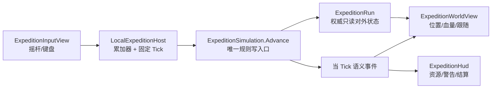

# 百炼 Like 技术先行 T1 阶段实施计划

目标读者：AI。

## 1. 阶段目标

- 文档状态：实施中；纯规则、独立灰盒场景和自动化门禁已完成，人工手感与目标设备验证待执行。
- 上位方案：[百炼 Like 技术先行落地方案](./百炼Like技术先行落地方案.md)。
- 前置计划：[P0 平台冒烟](./P0平台冒烟实施与记录.md)、[T0 阶段实施计划](./T0阶段实施计划.md)。
- 预计 Codex 有效工时：16–28 小时；不包括 SDK/模块下载、人工试玩等待和平台审核。
- T1 只交付 2–3 分钟本地手感切片，证明移动、跟随、稳定自动目标、自动战斗/采集、Boss 走位和返回结算。
- T1 不接 Server、Shared、网络、登录、MongoDB、正式配置表或旧 RPG 地图/战斗。
- 本文是实施计划，不授权代码、场景、资源、配置或 Git 提交。实施前必须另有写入授权并重新建立 Git 基线。

T1 的单一产品门禁：在 Editor 和 P0 允许的目标环境中可直接试玩，且玩家的移动、目标选择和 Boss 躲避会改变本局过程。编译通过、场景能打开或自动化测试通过都不能单独代替这个门禁。

## 2. 开工前置与当前基线

### 2.1 硬前置

1. P0 最终状态必须是“通过”“条件通过”或负责人明确的“豁免”。P0 为“失败”时可以单独做 Editor 手感试验，但 T1 不得标记为完整通过。
2. T0 的同源 `GameplayCore`、.NET 测试、边界脚本和精确 Unity Editor 编译证据必须成立；T0 当时的
   `MoveCommand`、`ExpeditionState` 和 `ExpeditionSession` 只是历史实现，不是兼容边界。
3. T1 已按实际玩法推翻 T0 临时 API；移动、归一化、非法输入、固定 Tick 和确定性行为由新模型回归测试承接。
4. 所有目标文件和父目录不得存在归属不明的并行改动。

### 2.2 文档编写时已核实事实

- Unity 版本为 `2022.3.62f3c1`，并已安装 `com.unity.test-framework 1.1.33`。
- 仓库当前跟踪 `GameScene.unity` 和 `SampleScene.unity`；它们仍是旧 RPG 入口。
- 现有 `PlayerController`、`GameSceneEntry`、`VirtualJoystick` 和 `CameraFollow` 服务于旧地图、网络位置与旧 UI，不是 T1 复用入口。
- `GameplayCore`、`gameplay-core/GameplayCore.csproj` 和 `tests/GameplayCore.Tests` 已由 T0 建立；T1 直接替换临时业务
  API，不复制源码、不改变同源编译边界。

实施时必须重新验证上述事实；本节不替代当时的代码和 Git 现场。

## 3. 可玩契约

### 3.1 唯一流程

```text
进入竖屏灰盒 -> 单指/键盘带队移动
-> 靠近一组普通敌人并自动战斗
-> 靠近一个资源点并自动采集
-> 触发 Boss 警告并通过移动躲开至少一次伤害
-> 击败 Boss -> 进入出口 -> 看到本局结算 -> 可立即重开
```

灰盒只有一条固定短路线，不做随机房间、迷雾、Zero、基地、名册或正式资源。随机房间和第二局永久成长属于 T2。

### 3.2 最小内容

| 对象 | T1 内容 | 不扩展到 |
| --- | --- | --- |
| 队伍 | 1 名主角 + 2 名伙伴的灰盒表现 | 编队、养成、英雄独立寻路 |
| 普通敌人 | 1 组、一种行为、可自动攻击 | 多种 AI、技能树、掉落表 |
| 资源 | 1 个资源点、1 种局内资源 | 背包、正式经济、配置表 |
| Boss | 1 个 Boss，周期性地面警告和延迟伤害 | 行为树、多阶段、复杂动画 |
| 出口 | Boss 死亡后开放，进入即结算 | 服务端奖励、存档、基地 |
| 时长 | 正常首次完成目标 2–3 分钟 | 正式 8–12 分钟局长 |

### 3.3 首轮调参起点

以下是首次可玩的起点，不是产品定案：

- 核心 Tick 以 15 Hz 起步，必须实测 10/15/20 Hz，保留手感合格的最低值。
- 队伍根速度约 4–5 世界单位/秒，摇杆死区 0.15，方向长度统一裁剪到 1。
- 普通敌人使玩家能在 10–20 秒内看到首次攻击、受击和死亡反馈。
- 资源采集持续 2–4 秒，每次采集事件有数值或视觉反馈。
- Boss 警告不少于 0.8 秒；站在危险区会明确受伤，持续移出危险区必须能避免该次伤害。
- 目标离开获取半径后保留一个明确释放余量；不得用“每 Tick 重选最近对象”实现。

所有可调数值收口在一个 T1 灰盒定义工厂中，不散落在 MonoBehaviour 字段和魔法常量里，也不为此接入 CSV/资源热更。

## 4. 轻量调用链与责任



责任边界：

- `GameplayCore` 决定 Tick、队伍根逻辑位置、目标、冷却、伤害、采集、Boss 警告/命中和终态。
- `LocalExpeditionHost` 只把 Unity 帧时间转换为固定 Tick，读取当前方向和消费事件；它不重新计算任何战斗结果。
- Unity View 负责摇杆、键盘、镜头、灰盒物体、伙伴平滑跟随、插值、颜色/数字反馈和 UI。
- 伙伴局部跟随不参与规则判定；射程、命中、死亡和资源增加只读核心状态/事件。
- 主角和伙伴灰盒表现不互相使用物理碰撞体阻挡；阵型恢复是表现约束，不是小型 NavMesh 系统。
- T1 不提取通用 `IExpeditionHost`。T3 出现远端宿主这个第二真实消费者时，再从现有调用点提取最小契约。

`LocalExpeditionHost` 使用有上限的时间累加器：单帧最多追赶 5 个 Tick，超过时记录一次警告并丢弃超出上限的本地积压。这是灰盒防止卡顿后长时间追帧的策略，不是 T3 服务端调度规则。

## 5. `GameplayCore` 在 T1 的真实扩展

### 5.1 最小模型

T1 采用“开局数据、权威局内对象、单一规则推进”三层根模型：

| 概念 | 最小语义 |
| --- | --- |
| `ExpeditionSetup` | 可变开局数据；只在 `ExpeditionRun.Start` 外部边界集中校验并深复制 |
| `ExpeditionRun` | 直接持有一局全部权威状态和固定规则；不再套一层 `ExpeditionState` |
| `ExpeditionMember` | 一名成员的独立生命、攻击参数和攻击冷却；核心支持 1–5 人 |
| `ExpeditionEnemy` | 敌人生命、普通行动冷却和 Boss 警告状态 |
| `ExpeditionResource` | 资源点剩余量和采集冷却 |
| `ExpeditionPhase` | `Running` / `Completed` / `Failed`，禁止并列布尔状态 |
| `ExpeditionTargetKind + TargetId` | 当前目标的种类和稳定整数 ID；不再增加 `TargetRef` 包装层 |
| `ExpeditionEvent` | Tick、类型、源/目标、数值和必要位置，供 View 反馈与测试 |
| `ExpeditionSimulation` | `Advance` 是规则状态的唯一写入口 |

T1 固定工厂创建 1 名主角和 2 名伙伴，但核心人数边界是 1–5。三名成员各自拥有生命；死亡成员停止攻击，
只有全部成员死亡才进入 `Failed`。结算所需 Tick、击杀数和局内资源直接读取 `ExpeditionRun`，不再建立只为搬运
同一状态的 `ExpeditionResult`。

`ExpeditionRun`、成员、敌人和资源对外属性均只读。外部不能设置 Tick、位置、血量、当前目标、资源或阶段。

不新增 Manager、System 目录、服务定位器、通用 ECS、反射注册、技能编辑器、行为树、规则插件和通用事件总线。

### 5.2 `Advance` 顺序

每个 Tick 的唯一顺序固定为：

1. 在 `Advance(run, directionX, directionY, events)` 边界校验并归一化方向，Tick 增加一次。
2. 积分队伍根位置，并约束在灰盒活动边界。
3. 推进 Boss 警告：在警告开始时锁定危险区，命中 Tick 只根据当时队伍根位置判定。
4. 校验旧目标，必要时按明确优先级和稳定 ID 获取新目标。
5. 推进队伍自动攻击或采集，生成当 Tick 语义事件。
6. 处理仍存活敌人的最小攻击，然后处理死亡、资源耗尽和出口开放。
7. 校验 `Completed` / `Failed` 终态并只生成一次结果事件。

普通敌人每次行动只攻击一名存活成员，按稳定 ID 和该敌人的行动次数轮转；Boss 警告命中则伤害每一名存活成员。

终态后再调用 `Advance` 不再推进 Tick、不发生攻击/采集，也不重复产生结果。重新开始必须根据同一开局数据创建
新的 `ExpeditionRun`。

### 5.3 目标稳定规则

1. 当前目标存活、可交互且没有超过“获取半径 + 释放余量”时保持不变。
2. 当任一存活敌人进入威胁半径时，敌人优先于资源；这是一次有规则的打断，不是每 Tick 在两类目标间往返。
3. 同类候选先比较距离，距离相同时使用稳定整数 ID，不依赖集合遍历偶然顺序。
4. 目标死亡、耗尽、不可交互或超过释放半径才重选。
5. View 可以表现转向和飞行物，但不得通过物理碰撞或动画回调改变目标与命中结果。

### 5.4 事件边界

T1 事件只需要覆盖：

- 目标变更；
- 攻击/受击/死亡；
- 采集/资源耗尽；
- Boss 警告开始、命中或躲避；
- 出口开放；
- 完成或失败。

`Advance` 接收调用方拥有的事件缓冲容器；调用方每 Tick 清空并复用，核心不为每 Tick 创建 List 或 LINQ 链。
事件是表现与测试证据，权威状态仍以 `ExpeditionRun` 为准。

## 6. 计划文件

以下是新根模型和灰盒入口的实际文件边界。

### 6.1 新增：纯规则

| 文件 | 唯一职责 |
| --- | --- |
| `client/Assets/Scripts/GameplayCore/ExpeditionSetup.cs` | 开局数据结构与创建前集中校验 |
| `client/Assets/Scripts/GameplayCore/ExpeditionRun.cs` | 一局的固定规则、阶段、目标和全部权威状态 |
| `client/Assets/Scripts/GameplayCore/ExpeditionObjects.cs` | 成员、敌人和资源的局内状态 |
| `client/Assets/Scripts/GameplayCore/ExpeditionEvent.cs` | 当 Tick 表现事件契约 |
| `client/Assets/Scripts/GameplayCore/ExpeditionSimulation.cs` | 固定顺序推进一 Tick 的唯一规则入口 |

### 6.2 新增：Unity 灰盒

| 文件 | 唯一职责 |
| --- | --- |
| `client/Assets/Scripts/View/Expedition/Client.Expedition.asmdef` | 只引用 `GameplayCore` 的 Unity 灰盒程序集 |
| `client/Assets/Scripts/View/Expedition/LocalExpeditionHost.cs` | Unity 帧到固定 Tick 的本地适配 |
| `client/Assets/Scripts/View/Expedition/ExpeditionHandfeelEntry.cs` | 组装一局、创建灰盒定义并处理重开 |
| `client/Assets/Scripts/View/Expedition/T1ExpeditionSetupFactory.cs` | 集中保存 T1 灰盒的全部可调开局数值 |
| `client/Assets/Scripts/View/Expedition/ExpeditionInputView.cs` | 摇杆、触摸与 Editor 键盘方向输入 |
| `client/Assets/Scripts/View/Expedition/ExpeditionWorldView.cs` | 创建/更新灰盒地面、敌人、资源、出口和 Boss 警告 |
| `client/Assets/Scripts/View/Expedition/SquadView.cs` | 主角和两名伙伴的插值、阵型跟随与回位 |
| `client/Assets/Scripts/View/Expedition/ExpeditionHud.cs` | 血量、资源、用时、结算与重开 UI |
| `client/Assets/Scripts/View/Expedition/WeChat/Client.Expedition.WeChat.asmdef` | 隔离微信 SDK 依赖的目标平台适配程序集 |
| `client/Assets/Scripts/View/Expedition/WeChat/WeChatTouchInputAdapter.cs` | 在微信目标构建为 EventSystem 安装 SDK 触摸结束/取消覆盖 |
| `client/Assets/Scenes/ExpeditionHandfeelScene.unity` | 隔离旧 RPG 的 T1 直接可玩入口 |

灰盒使用 Unity Primitive、纯色材质和运行时 UI；不引入 Asset Store 包、正式模型、动画器、音频系统或对象池泛化层。
微信触摸适配保持在独立平台程序集内，不让通用 T1 View 直接依赖 `Wx`。Editor 只编译并装载该适配器，不初始化微信
SDK；真实触摸开始、移动、结束、取消及前后台切换仍须由 `TEST-T1-WECHAT-01` 在开发者工具和真机验证。

### 6.3 新增：测试

| 文件 | 覆盖范围 |
| --- | --- |
| `tests/GameplayCore.Tests/ExpeditionSimulationTests.cs` | 移动回归、开局边界和运行态所有权 |
| `tests/GameplayCore.Tests/ExpeditionTargetingTests.cs` | 目标锁定、释放余量、敌人优先和稳定 ID |
| `tests/GameplayCore.Tests/ExpeditionActionTests.cs` | 攻击冷却、伤害、死亡、采集和资源耗尽 |
| `tests/GameplayCore.Tests/ExpeditionBossTests.cs` | 警告位置锁定、站立命中、移出躲避 |
| `tests/GameplayCore.Tests/ExpeditionLifecycleTests.cs` | 出口门禁、唯一终态、确定性和重开隔离 |
| `tests/GameplayCore.Tests/ExpeditionTestFactory.cs` | 行为测试共用的最小开局数据 |
| `client/Assets/Tests/PlayMode/Client.Expedition.PlayMode.asmdef` | 引用 Unity Test Framework、T1 通用/微信 View 和 `GameplayCore` |
| `client/Assets/Tests/PlayMode/ExpeditionHandfeelPlayModeTests.cs` | 场景边界、视图状态、事件表现、跟随、重开和微信适配装载 |

PlayMode 测试不引用或反射访问 `Assembly-CSharp` 中的旧 RPG 类型；新灰盒程序集独立可引用。

### 6.4 修改

| 文件 | 修改 |
| --- | --- |
| `client/Assets/Scripts/GameplayCore/MoveCommand.cs` | 删除被新 `Advance` 输入边界取代的 T0 临时类型 |
| `client/Assets/Scripts/GameplayCore/ExpeditionState.cs` | 删除被 `ExpeditionRun` 直接所有权取代的 T0 临时类型 |
| `client/Assets/Scripts/GameplayCore/ExpeditionSession.cs` | 删除被 `ExpeditionSimulation` 取代的 T0 临时入口 |
| `tests/GameplayCore.Tests/ExpeditionSessionTests.cs` | 删除旧 API 测试；移动行为迁入新模型测试 |
| `scripts/check-gameplay-core-boundary` | 允许 `Client.Expedition` 单向引用核心，继续禁止 Shared/ClientLogic/Server/Robot 引用 |
| `client/ProjectSettings/EditorBuildSettings.asset` | 将 T1 场景置于本阶段可直接启动的首个入口，保留旧场景不删除 |

Unity 为新增目录、场景、`.asmdef` 和 `.cs` 生成的 `.meta` 是预期产物，但必须由精确 Editor 生成，禁止手写、复制 GUID 或按文本猜测。

### 6.5 同步文档与知识

- `docs/技术先行版本计划/T0阶段实施计划.md`；
- `docs/技术先行版本计划/T1阶段实施计划.md`；
- `docs/技术先行版本计划/百炼Like技术先行落地方案.md`；
- `docs/测试列表.md`；
- `docs/工作记录/2026-07.md`；
- `docs/工作记录/README.md`；
- 中枢 `projects/game1/line-kb/architecture.md`，仅同步已验证的 T1 架构入口和验证证据。

### 6.6 T1 不修改

- `shared/`、`client-logic/`、`server/`、`robot/` 和它们的项目文件；
- Protobuf 协议、消息注册、Transport、`TcpSession` 和登录链路；
- MongoDB、`PlayerEntity`、背包、邮件、任务和永久奖励；
- `GameEntry`、`GameSceneEntry`、`PlayerController`、`FightController`、`MapController` 和旧 RPG UI；
- `StreamingAssets/Tables`、配置生成工具和正式内容资源；
- P0 冒烟目录、SDK 依赖和平台后台配置。

若 T1 必须修改上述文件才能可玩，停止并报告真实阻塞，不通过复用旧玩法或扩大架构绕过。

## 7. 自动化行为测试

### 7.1 .NET 核心测试

最低用例：

1. T0 移动、输入归一化和非法数值用例全部保留。
2. 当前敌人在释放半径内时，更近候选不导致每 Tick 切换。
3. 敌人和资源同时可达时，敌人只按规则打断一次；敌人消失后才回到资源。
4. 同距离候选始终使用稳定 ID 得到同一目标。
5. 攻击只在射程和冷却合法时生效，死亡后不再攻击或被选中。
6. 采集只在射程内按固定 Tick 节奏减少资源，耗尽和计数只发生一次。
7. Boss 警告开始后危险区不跟随玩家移动；留在区域内会受伤，移出则生成躲避事件且不扣血。
8. Boss 死亡前进入出口不结算；Boss 死亡后进入出口只进入一次 `Completed`。
9. 全体成员生命为零只进入一次 `Failed`，终态后 `Advance` 不再产生收益或结果事件。
10. 相同开局数据和方向流的两个 `ExpeditionRun` 得到相同最终状态和事件序列。
11. 重新创建 `ExpeditionRun` 不保留上一局血量、目标、资源、警告或终态。
12. 重复 ID、负生命/资源、非法半径、非正 Tick 率和超出活动边界的出口在创建 Run 前被拒绝。

对事件的断言必须包含 Tick 和关键 ID，不只断言“数量大于零”。

### 7.2 Unity PlayMode 测试

自动化只验证可稳定观测的边界：

1. T1 场景可单独进入，不创建 `Context`、网络会话或旧 `GameSceneEntry`。
2. 初始有 1 个主角表现、2 个伙伴表现、预期敌人、1 个资源点、1 个 Boss 和 1 个出口。
3. 注入一段固定方向后，主角表现向核心位置收敛，两个伙伴在有限时间内回到阵型距离。
4. 攻击、采集和 Boss 警告事件只改变对应表现，不回写核心状态；死亡成员变灰且队伍表现无碰撞体。
5. Boss 警告位置、半径、颜色和相机内可见性与核心事件一致。
6. 重开时新 Host 立即接管，旧 Host 不再推进；下一帧完成清理后仍只有一个活动 Host。
7. 干净场景只有一个 EventSystem；微信适配器在 Editor 可装载但不初始化微信 SDK。

摇杆实际手感、镜头构图、警告可读性和视觉反馈不得用 PlayMode 结果代替真实试玩。

## 8. 手感验收与记录

### 8.1 环境

至少执行：

| 环境 | 操作 | 用途 |
| --- | --- | --- |
| Unity Editor 9:16 Game View | 鼠标拖动摇杆 + 键盘备用 | 快速调参和回归 |
| P0 目标平台工具 | 真实触摸/指针输入 | 验证导出后输入、构图和稳定性 |
| 至少一台目标设备 | 完整玩一局并重开 | P0 已通过时的 T1 完整门禁 |

P0 为“条件通过”且真机被 AppID/域名等外部条件阻塞时，记录未测原因，T1 只能标记“条件通过”。

### 8.2 必须验证的手感

1. 从开始输入到主角明显移动无可感知的长停顿；10/15/20 Hz 中选出最低可接受值并记录。
2. 连续转向、小幅摇杆和放手停止均无持续漂移，摇杆不遮挡主要危险区。
3. 两名伙伴不互相卡住，急转弯后在 0.5 秒左右恢复阵型，不长时间掉出镜头。
4. 敌人和资源同时可达的固定场景中，目标不在两者间连续闪烁；记录一段 5 秒重叠场景的目标变更次数。
5. 首次攻击、受击、死亡、采集和资源耗尽都能仅凭灰盒颜色/数字/形状被分辨。
6. Boss 警告在命中前可读：不移动必须受伤，警告后立即移出必须至少成功躲避一次。
7. 没有移动时 Boss 不得自动成为无风险等待战；参数必须保留玩家走位价值。
8. 击败 Boss 后出口变化可辨认，结算中的用时、击杀和资源与局内一致，重开后全部归零。
9. 一次正常首玩完成时间在 2–3 分钟量级；超过时先缩短路线/血量，不通过增加系统填充。

### 8.3 结果记录

实施后在任务工作记录中留下：

- 执行日期、分支/HEAD、Unity 版本、平台工具版本和设备；
- 实际 Tick 率与 10/15/20 Hz 对比结论；
- 三次完整局的用时、终态、Boss 躲避次数和目标切换次数；
- 伙伴最大可观测掉队情况、重开次数和 Console Error；
- 目标环境 60 秒稳定运行的帧率、内存或平台能提供的对应指标；
- 通过、条件通过或失败的唯一结论，以及是否准入 T2。

### 8.4 当前自动化记录（2026-07-30）

- 分支/基线：`main`，开工基线 `04c74efeb823a5366b8e324b041e85f7b09aee32`。
- 纯规则：`dotnet test tests/GameplayCore.Tests/GameplayCore.Tests.csproj --no-restore`，33/33 通过。
- Unity：`2022.3.62f3c1` 无界面编译通过；PlayMode 6/6 通过。
- PlayMode 已验证：隔离场景与唯一 EventSystem、微信适配器的 Editor 装载边界、对象数量与灰盒光照、无碰撞体、
  固定方向移动、伙伴回位、死亡灰显、Boss 警告位置/半径/颜色/相机可见性、单帧最多追赶 5 Tick，以及重开
  当帧旧 Host 停止推进、下一帧仅保留一个活动 Host。
- Free Aspect 短画面冒烟发现隔离场景缺少光照，已由 `ExpeditionWorldView` 创建运行时方向光和环境光；复核时
  三名成员、敌人、HUD 与摇杆均可辨识。该记录只证明基础可读性，不代替 9:16 手感和完整局验证。
- 当前默认 15 Hz 只是首轮参数；10/15/20 Hz 人工手感对比尚未执行。
- Editor 9:16 人工完整局、三局记录、目标平台工具和真机完整局尚未执行，因此 T1 尚无最终通过结论，也不准入 T2。

## 9. 工作包

### T1.0 基线与前置验收（0.5–1 小时）

1. 重新读取项目档案，验证真实路径、Git 根、origin、分支和 HEAD。
2. 记录 `git status --short --untracked-files=all`、cached diff 和进行中的 Git 操作。
3. 核对 P0 最终状态和 T0 Definition of Done 证据。
4. 逐项核对第 6 节目标路径与并行改动归属。

门禁：T0 真实交付可供扩展，实际计划 diff 唯一且无重叠归属。

### T1.1 扩展纯规则状态（4–6 小时）

1. 建立开局数据、阶段、稳定 ID、队员/敌人/资源状态和集中边界校验。
2. 由 `ExpeditionRun` 直接拥有局内状态，并确保外部不能跳过 `ExpeditionSimulation` 修改。
3. 按第 5.3 节实现目标保持和稳定候选排序，先写失败用例再实现。
4. 保留 T0 移动、归一化、非法输入和固定 Tick 行为，不保留 T0 临时 API。

门禁：目标锁定、敌人优先和稳定 ID 行为测试通过；核心仍无 Unity/Shared/网络依赖。

### T1.2 完成战斗、采集、Boss 与终态（3–5 小时）

1. 按第 5.2 节固定 `Advance` 顺序。
2. 实现固定 Tick 冷却、伤害、死亡、采集和资源耗尽。
3. 实现“警告时锁定位置 -> 延迟判定命中”的单一 Boss 行为。
4. 实现出口门禁、完成/失败和不可重复的局内结果。
5. 对相同命令流比较状态与完整事件序列。

门禁：第 7.1 节测试全部通过，且无每 Tick 无界分配、全局随机或墙钟读取。

### T1.3 建立本地 Host 和可玩灰盒（4–7 小时）

1. 创建 `Client.Expedition` 程序集，只单向引用 `GameplayCore`。
2. 实现有上限的本地 Tick 宿主和调用方事件缓冲。
3. 用一个工厂构建固定 T1 定义，创建独立场景、摇杆/键盘、斜俯视镜头和灰盒对象。
4. 将主角表现插值到核心队伍根；伙伴按阵型偏移平滑跟随，去除互相阻挡碰撞。
5. 消费攻击、受击、采集、警告、出口和结算事件，只改变表现。
6. 用精确 Unity Editor 生成 `.meta` 和场景，将 T1 场景放到本阶段启动入口。

门禁：Editor 中能从新场景完整玩到结算并重开，无网络/旧 RPG 入口被启动。

### T1.4 自动化、目标环境与调参（2–4 小时）

1. 完成第 7.2 节 PlayMode 用例，在精确 Editor 运行。
2. 分别以 10/15/20 Hz 完整试玩，保留最低合格 Tick 率。
3. 在 P0 允许的平台工具和设备导出/运行；不修改生产 AppID 或外部平台配置。
4. 按第 8 节做三次完整局，调整路线长度、血量、冷却、采集时间和 Boss 警告。

门禁：手感验收通过或得到明确的失败结论；不用增加系统掩盖移动/目标/Boss 不好玩。

### T1.5 收口（2–5 小时）

1. 执行第 10 节全部验证并复查 Console/测试报告。
2. 核对 game1 实际 diff 只包含第 6 节及 Unity 对应 `.meta`；中枢只包含第 6.5 节列出的知识条目。
3. 删除未被真实行为使用的空接口、Manager、临时调试开关和测试特例。
4. 按项目规则更新当月工作记录，填写第 8.3 节证据与唯一门禁结论。
5. 未获得提交授权时保持未提交并精确报告。

门禁：Definition of Done 全部满足，否则 T1 保持未完成且不准入 T2。

## 10. 验证顺序

在真实项目根执行：

```bash
dotnet build gameplay-core/GameplayCore.csproj
dotnet test tests/GameplayCore.Tests/GameplayCore.Tests.csproj
bash scripts/check-gameplay-core-boundary
bash scripts/check-all
git diff --check
git status --short --untracked-files=all
```

Unity 验证：

1. 使用 `2022.3.62f3c1` 刷新并编译，记录 Console Error。
2. 运行 PlayMode 测试程序集，保留 XML/日志或 Editor 测试结果证据。
3. 在 9:16 Game View 完整玩三局，其中一局故意站立接 Boss 伤害，一局至少成功躲避一次。
4. P0 允许时，导出到 Git 根外的任务专用目录，在目标平台工具和设备运行。
5. 执行后重新检查 Git 状态，区分计划 `.meta`/场景与 Editor 意外 reserialize。

证据口径：

| 证据 | 能证明 | 不能证明 |
| --- | --- | --- |
| .NET 测试 | 纯规则顺序、边界和可重复性 | Unity 手感、镜头和目标平台 |
| 边界脚本 | 当前代码没有指定禁止依赖 | 玩法正确或没有所有性能问题 |
| PlayMode 测试 | 新场景组装、视图更新和重开清理 | 人类感知的操作响应与警告可读性 |
| Editor 实玩 | 9:16 下的基础手感与完整流程 | 小游戏导出后的真机表现 |
| 目标设备实玩 | 当前设备上的输入、性能与闭环 | 服务端权威、反作弊或全机型覆盖 |

## 11. 停止条件

出现以下任一情况时停止并报告：

1. P0 为“失败”且没有豁免，或 T0 Definition of Done 未完成。
2. 目标文件或父目录存在归属不明的并行改动。
3. 必须让 `GameplayCore` 引用 UnityEngine、Shared、网络、文件、墙钟或第三方运行时包。
4. 必须修改 Server、协议、登录、玩家聚合、配置表或旧 RPG 类型才能完成灰盒。
5. 新 Unity 程序集无法在不引用 `Assembly-CSharp` 旧类型的情况下独立可玩。
6. 精确 Unity 版本导入或测试产生第 6 节以外的跟踪文件变化，且无法确认归属。
7. 两轮只调整路线、速度、半径、冷却和警告后，移动、目标稳定或 Boss 走位仍不达门禁；此时返回产品/规则判断，不新增架构。
8. 目标平台上的输入或帧时问题证明 P0 基线不成立；先回到最短平台失败链路。
9. 为通过测试需要添加测试专用生产分支、固定点、回滚、ECS、对象池框架或通用插件层。

## 12. Definition of Done

- [x] P0 准入状态和 T0 完成证据已复核。
- [x] T0 移动行为仍全部通过，新核心模型只服务于 T1 真实行为。
- [x] 目标锁定、攻击、采集、Boss 警告/躲避、出口和唯一终态测试全部通过。
- [x] `GameplayCore` 仍不依赖 Unity、Shared、网络、服务端、文件或墙钟。
- [x] T1 场景与旧 RPG 入口隔离，未启动登录、Session 或旧地图。
- [x] 1 主角 + 2 伙伴可辨认，伙伴无碰撞体且自动化验证转向后能回位。
- [ ] 敌人与资源重叠场景中无持续目标抖动。
- [ ] 站立会被 Boss 警告命中，警告后移出至少成功躲避一次。
- [ ] 三次完整局的用时、目标变更、Boss 躲避和终态已记录。
- [ ] 10/15/20 Hz 已对比并留下最低合格 Tick 率及理由。
- [x] 精确 Unity Editor 编译和 PlayMode 测试通过，Console 无阻断 Error。
- [ ] P0 允许的目标环境已完整玩一局；未测时已明确降级为条件通过。
- [x] 重开不残留上局状态、GameObject、材质、UI 或多个 Host。
- [x] 实际 diff 不包含 Server、Shared、ClientLogic、协议、配置表、持久化和旧 RPG 变更。
- [ ] 最终报告区分 .NET、PlayMode、Editor 试玩、目标设备和未执行验证。
- [x] 当月工作记录已按项目规则更新，无计划外 Git 变化。

全部完成后才准入 T2。T1 通过只证明本地手感切片成立，不证明服务端权威、反作弊、永久成长或 8–12 分钟完整《异界迷宫》闭环。

## 13. T2 移交输入

T1 通过时只向 T2 移交：

- 已选定的最低合格 Tick 率和一组有实玩证据的手感参数；
- 稳定的队伍根、目标锁定、自动攻击/采集、Boss 警告和终态规则；
- 同源纯规则状态/事件与隔离的 Unity 灰盒调用点；
- 一份可复现的灰盒定义和三次完整局记录；
- 已知手感问题和未验证设备/环境清单。

T2 再增加 6–10 房间、8–12 分钟、局内结算、一次基地升级和第二局；不在 T1 收口时顺手加入。
