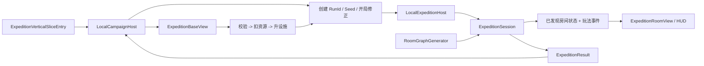

# 百炼 Like 技术先行 T2 阶段实施计划

目标读者：AI。

## 1. 阶段目标

- 文档状态：待实施。
- 上位方案：[百炼 Like 技术先行落地方案](./百炼Like技术先行落地方案.md)。
- 前置计划：[T1 阶段实施计划](./T1阶段实施计划.md)。
- 预计 Codex 有效工时：5–9 小时；不包括人工试玩等待、平台预览协作和审核。
- T2 在已通过的 T1 手感切片上扩成《异界迷宫》的本地局内外小闭环：6–10 个种子可复现房间、
  8–12 分钟首局、一次本地结算、一个基地设施升级，以及带着升级效果进入第二局。
- T2 不接 Server、Shared、网络、登录、MongoDB、正式配置表、正式资源、旧 RPG 或第二产品。
- 本文是实施计划，不授权代码、场景、资源、平台预览、Git 暂存或提交。实施前必须另有对应授权并重新建立 Git 基线。

T2 的单一产品门禁：完整走通“第一局结算 -> 消耗带回资源升级一个设施 -> 开始第二局”，且第二局第一次战斗能直接观察到升级效果；成功流程同时包含已走路线、规则危险提示，失败流程能够返回基地并再次出发。房间数量、运行时长或 UI 页面数量都不能单独代替这个门禁。

工时校准依据：T0 原预计 8–12 小时，实际有效工时约 2 小时。T2 比 T0 多出房间推进、本地 Campaign、Unity 局内外切换和目标设备闭环，按约 2.5–4.5 倍实际复杂度估算为 5–9 小时；不因文件数量机械放大工时。

## 2. 开工前置与当前基线

### 2.1 硬前置

1. T1 Definition of Done 必须全部完成，最终状态只能是“通过”或负责人明确接受外部环境缺失的“条件通过”。
2. T1 必须留下实际 Tick 率、三次完整局用时、目标切换次数、Boss 躲避结果、首次攻击/采集节奏和目标设备问题；缺少这些输入时不得猜参数扩局长。
3. 实施时按 T1 的真实公开模型修订第 6 节文件清单；不得根据尚未实现的计划类型强行建立第二套模型。
4. P0 的目标平台结论仍需成立。目标平台工具或设备出现新的启动、输入、内存或构建失败时，先回到最短平台失败链路。
5. 所有目标文件和父目录不得存在归属不明的并行改动。

### 2.2 文档编写时已核实事实

- P0 已在微信开发者工具和 iPhone 14 Pro 上通过，证明固定 SDK、AOT、随包异步样例和平台 TCP 的最小链路；它不证明 T2 玩法场景已经通过。
- T0 已于 2026-07-30 通过，当前 `GameplayCore` 只有 `MoveCommand`、`ExpeditionState` 和 `ExpeditionSession` 三个真实类型，同一源码由 Unity 与 `netstandard2.1` 编译。
- T1 当前仍是待实施计划；队伍、目标、战斗、采集、Boss、事件、结果和 Unity 灰盒类型尚不能视为代码事实。
- Unity 精确版本为 `2022.3.62f3c1`；新增 Unity 资源的 `.meta` 只能由该 Editor 生成。
- 旧 `GameScene`、旧地图、旧战斗和旧 UI 不属于 T2 入口。

实施时必须重新验证上述事实；本节不替代当时的源码和 Git 现场。

## 3. 可玩契约

### 3.1 唯一流程

```text
进入本地基地/出发页
-> 以显式 Seed 开始第一局
-> 探索 6–10 个房间并完成战斗、采集和一次可选路线取舍
-> 看到已走路线标记并响应一次规则驱动的危险提示
-> 击败 Boss 并从出口返回
-> 看到局内资源结算并只入账一次
-> 消耗本地资源把唯一设施从 0 级升到 1 级
-> 以新 RunId 和新 Seed 开始第二局
-> 在第一次战斗中看到升级后的数值或节奏差异
```

T2 只要求完整完成第一局，并把第二局推进到升级效果可观察；不以再次完整完成第二局作为阶段门禁。

除上述成功流程外，T2 还必须完成一次失败恢复：局内死亡 -> 失败结果只消费一次 -> 按临时比例带回 -> 返回基地 -> 可以开始新的 Run。失败后不要求资源足够升级。

### 3.2 最小内容

| 对象 | T2 内容 | 不扩展到 |
| --- | --- | --- |
| 房间图 | 6–10 个稳定 ID 房间；起点、普通战斗、资源/混合、Boss、出口和最多 2 个可选支路 | 无限迷宫、运行时几何生成、NavMesh 烘焙 |
| 随机 | 显式 `uint` Seed + 项目自有小型整数 PRNG；同一构建同 Seed 可复现 | `System.Random`、跨历史版本重演协议、加密随机 |
| 内容 | 复用 T1 敌人、资源、Boss 和反馈；用少量房间模板组合 | 新技能树、多 Boss、多套正式关卡内容 |
| 路线提示 | 当前目标、已发现出口、已走路线标记和一次规则危险提示 | Zero 品牌表现、自动寻路、未探索地图透视、生成式 AI |
| 局内资源 | 1 种中性带回资源；主线/Boss 提供升级保底，支路只提供额外收益 | 背包、掉落表、正式经济、货币体系 |
| 基地 | 1 个设施，T2 只允许从 0 级升到 1 级，并有灰盒颜色、尺寸或形态变化 | 多设施、建造队列、离线收益、正式基地美术 |
| 成长效果 | 1 个开局快照化的全队战斗修正，以固定首战敌人对比第二局效果 | 名册、角色升级、装备、技能养成 |
| 局长 | 第一局目标 8–12 分钟 | 通过堆血、重复波次或等待填满时长 |

T2 的“随机房间”是种子决定的房间图与模板组合，不是程序化生成墙体、地形和美术。房间内继续使用 T1 已验证的纯规则边界和灰盒表现。

### 3.3 T2 临时参数门禁

T2.0 必须用 T1 实测数据冻结一份灰盒参数记录，至少包含：

| 参数 | T2 默认策略 | 定案依据 |
| --- | --- | --- |
| 房间数 | 从 6 个起测，只有内容节奏成立时才增至 10 个 | 三次首局时长和无效等待占比 |
| 目标局长 | 8–12 分钟 | 真实试玩，不以自动运行耗时替代 |
| 失败资源保留 | 未有产品决定时临时设为 100%，并明确标记为灰盒值 | 不让未定惩罚阻断闭环；不代表正式经济 |
| 成功保底 | 任意合法成功路线的主线/Boss 保底带回量不低于首次升级价格 | 固定 Seed 最低收益路线的自动化结果 |
| 升级价格 | 不高于成功保底；通常取三次完整局中位收益的 60%–80% | 三个固定 Seed 的实际收益与最低路线验证 |
| 升级效果 | 默认全队基础伤害 `+20%`，可按整数伤害的可辨认程度调整 | 第二局第一次战斗必须肉眼和测试均可辨认 |
| 第二局 Seed | 由 Campaign Seed 与 RunIndex 通过固定整数混合得到 | 重开可复现且不读取墙钟 |

T2.0 冻结房间数后，三次成功流程试玩使用相同房间数，只改变 Seed。临时值只服务技术闭环；正式失败损失、经济速度和成长曲线仍需产品决定，不得把 T2 灰盒值直接写入正式表。

## 4. 轻量调用链与 T2 边界



责任边界：

- `GameplayCore` 决定房间图、房间状态、可通行出口、当前目标、局内资源、终态、结算结果和基地升级规则。
- `LocalCampaignHost` 只保存本次应用运行期间的 Campaign Session，创建一局、转交唯一结果并驱动基地/出发 UI；它不重算奖励和成长效果。
- `LocalExpeditionHost` 继续只处理 Unity 帧到固定 Tick 的适配，不升级为通用宿主接口。
- Unity View 只展示核心公开的已发现房间、当前出口和事件，不根据 GameObject 碰撞或按钮直接增加资源、开门、完成房间或升级设施。
- T2 没有第二个真实宿主消费者，因此不提取通用 `IExpeditionHost`，也不建立 DTO、快照头或请求封装。

### 4.1 本地进度不是反作弊权威

T2 的 Campaign 和基地数据只存在客户端进程内存中，关闭应用后允许重置。禁止在 T2 引入 `PlayerPrefs`、JSON 文件、`Application.persistentDataPath`、云存储或 MongoDB。

纯规则类型保持只读状态、唯一结算和先扣后加，只是为了验证 T2 的业务不变量；它不能阻止修改内存、篡改客户端或重启回档。T2 不得宣称已经完成 PvE 同步、反作弊、持久化或正式经济，这些事项不在本文范围内。

### 4.2 未探索信息边界

本地构建必然持有完整房间图，因此 T2 无法提供真正的防透视安全边界；但公开给 View 的状态仍只包含：

- 当前房间；
- 已发现房间；
- 当前可见出口及其已知目标；
- 当前房间内必要对象。

View 不接收 Seed、完整未探索拓扑或隐藏内容。该接口边界只验证 T2 的状态职责，不构成客户端防透视能力。

## 5. `GameplayCore` 在 T2 的真实扩展

### 5.1 房间图生成

最小房间图满足以下不变量：

1. 房间总数在冻结的 6–10 范围内，稳定整数 ID 唯一。
2. 恰好有一个起点、一个 Boss 房和一个出口房。
3. 所有房间都可从起点到达，Boss 路径不依赖尚未开放的出口；Boss 到出口始终可达。
4. 出口只能在 Boss 房完成后开放；可选支路最多 2 个且至少一个提供额外资源，主路线不依赖进入支路。
5. 每个房间出口双向一致，没有自环、悬空引用和重复边。
6. 房间内实体 ID 在整局唯一，不能因切换房间与旧目标发生碰撞。
7. 任意合法成功路线都包含主线/Boss 保底资源，并满足保底带回量不低于首次升级价格；支路收益不参与保底。

房间图、房间定义和实体初始定义是不可变、可复用数据。当前房间、发现、清理、生命、目标和资源剩余量由每个 `ExpeditionSession` 独占；两个 Session 可以共享同一 Definition，但不能共享任何可变进度。对外集合使用不可变副本或只读投影，调用方不能通过数组/List 引用回写核心。

生成器只使用显式 Seed 和写在项目中的小型 32 位整数算法。Seed 为 0 时按文档化常量归一；禁止读取墙钟、`Guid.NewGuid()`、全局随机或集合偶然遍历顺序。

同一构建中，同一 Seed 必须得到相同的房间类型、边、实体 ID 和内容放置顺序。T2 不承诺代码升级后仍按旧 Seed 复现，也不在本阶段增加生成器版本协议。

### 5.2 房间生命周期

房间进度使用单一枚举表达：

`Hidden -> Discovered -> Cleared`

`CurrentRoomId` 与房间进度正交：当前房间可以是 `Discovered` 或已完成的 `Cleared`；回到已清房间不会重生内容或重复奖励。

约束：

1. 开局起点为 `Discovered` 和当前房间，相邻出口可按规则揭示；未探索房间内容不进入公开状态。
2. 房间明确声明 `Combat`、`Resource`、`MixedAll` 或 `Boss` 完成条件；不得用含糊的战斗/采集任一完成代替。
3. 使用固定房间矩形、有限方向门槽、门触发区和目标入口点；每 Tick 最多切换一次，锁门触发不改变状态。
4. 合法切换时 Session 原子更新当前房间，把队伍放到目标门内侧，并清除旧房间全部目标、警告和临时效果。
5. 普通房间满足声明的完成条件后进入 `Cleared` 并开放出口；不得由 View 直接标记。
6. Boss 房在 Boss 死亡前锁门，死亡后只生成一次房间完成和出口开放事件。
7. 进入出口房并满足条件后只生成一次终态结果；终态后不能继续获得局内资源。

T1 的 Step 顺序保持不变，只在“队伍根移动并约束边界”之后加入合法房门切换，在目标获取前完成房间上下文切换。不得为房间系统重写已经通过的目标、攻击、采集和 Boss 规则。

### 5.3 Campaign、结算与基地升级

T2 增加一个窄 `ExpeditionCampaignSession`，只负责：

- 当前 RunId、RunIndex 和 Seed；
- 已入账资源；
- 唯一设施等级；
- 当前是否有活动局；
- 当前局结果是否已消费；
- 最近一次不可变 `SettlementReceipt`，用于有界重复调用。

结果消费顺序：

1. `ExpeditionResult` 只能由对应 Session 产生并保持不可变；View 不构造或直接消费原始 Result。
2. 校验 Campaign 存在对应活动 RunId，结果已经终态且尚未消费。
3. 根据临时结算策略计算本次可带回量和入账后余额，并在写状态前排除负数与整数溢出。
4. 先将当前局标记为已消费并结束活动局，防止重复提交。
5. 再增加已入账资源，保存不含 Seed 的 `SettlementReceipt` 并返回给 View。
6. 相同结果立即重复，或开始第二局后再次重复，均返回最近回执且不增加资源；同 RunId 但内容不同、非终态或更旧结果全部拒绝且状态不变。

基地升级遵循“先扣后加”：

1. 在任何状态变化前校验设施等级、价格、资源余额和当前不在局内。
2. 计算完整扣除与升级效果。
3. 先扣除已入账资源。
4. 再把设施从 0 级升到 1 级并生成新的开局修正。
5. 余额不足、重复升级或局内升级均不改变任何状态。

T2 只有一个设施和一个升级，不建立通用建筑树、队列、Repository、事务或补偿系统。

### 5.4 第二局隔离

第二局开始时：

- 分配新的 RunId、RunIndex 和 Seed；
- 根据设施等级生成不可变的开局修正并复制进新 `ExpeditionDefinition`；
- 重建生命、冷却、目标、Boss 警告、房间发现和局内资源；
- 保留 Campaign 已入账资源和设施等级；
- 禁止进行中的局读取可变基地状态，避免局中升级改变结果。

第一局和第二局的首个战斗房使用同一类对照敌人和防御口径；Seed 可以改变后续房间，但不得让首战差异掩盖升级效果。升级页显示伤害旧值与新值，基地灰盒设施同步产生一次可见变化。

自动化必须证明第二局第一次合法攻击使用升级后伤害，同时第一局 Session、事件缓冲和 GameObject 均未残留。

## 6. 计划文件

以下路径以 T1 按计划交付为前提。实施前必须根据 T1 实际类型合并或改名，并把最终允许修改清单写入任务基线；不得同时保留两套同义模型。

### 6.1 新增：纯规则

| 文件 | 唯一职责 |
| --- | --- |
| `client/Assets/Scripts/GameplayCore/ExpeditionRoom.cs` | 分别定义不可变 `RoomDefinition` 与单局 `RoomProgressState`，不共享可变集合 |
| `client/Assets/Scripts/GameplayCore/ExpeditionRoomGraph.cs` | 不可变房间/出口拓扑与完整图不变量校验，不承担动态公开视图 |
| `client/Assets/Scripts/GameplayCore/ExpeditionRoomGenerator.cs` | 显式 Seed、私有整数 PRNG 和 6–10 房间图生成 |
| `client/Assets/Scripts/GameplayCore/ExpeditionCampaignDefinition.cs` | T2 临时结算、升级价格与效果参数 |
| `client/Assets/Scripts/GameplayCore/ExpeditionCampaignState.cs` | RunIndex、已入账资源、设施等级和最近结算回执的只读状态 |
| `client/Assets/Scripts/GameplayCore/ExpeditionCampaignSession.cs` | 开局、唯一结果消费、先扣后加升级和第二局创建 |

简单枚举或只在一个职责中使用的小值对象可以与对应文件同置；不得为了文件表机械建立空类型。

### 6.2 新增：Unity 本地闭环

| 文件 | 唯一职责 |
| --- | --- |
| `client/Assets/Scripts/View/Expedition/LocalCampaignHost.cs` | 当前 Local Host/Session 的唯一生命周期所有者，并在探索与基地视图间切换 |
| `client/Assets/Scripts/View/Expedition/ExpeditionVerticalSliceEntry.cs` | 只做一次性组装和启动，不拥有首局/重开生命周期 |
| `client/Assets/Scripts/View/Expedition/ExpeditionRoomView.cs` | 展示静态房壳、门、已走路线和危险提示，不创建战斗/采集实体 |
| `client/Assets/Scripts/View/Expedition/ExpeditionBaseView.cs` | 展示结算回执、资源、设施可见变化、升级旧值/新值和再次出发 |
| `client/Assets/Scenes/ExpeditionVerticalSliceScene.unity` | 与旧 RPG 隔离的 T2 直接可玩入口 |

继续复用 T1 的输入、队伍、世界表现、HUD 和本地 Tick Host；不得复制一套 T2 View。T1 手感场景保留为快速回归入口，不在 T2 中删除。

### 6.3 新增：测试

| 文件 | 覆盖范围 |
| --- | --- |
| `tests/GameplayCore.Tests/ExpeditionRoomGraphTests.cs` | Golden 图签名、Seed 语料扫描、全图连通、稳定 ID、保底收益和支路不变量 |
| `tests/GameplayCore.Tests/ExpeditionRoomProgressionTests.cs` | 发现、回溯、清房、锁门、单 Tick 切门、效果清理和唯一出口结果 |
| `tests/GameplayCore.Tests/ExpeditionCampaignTests.cs` | 最近回执、重复/冲突结果、失败带回、资源入账和先扣后加升级 |
| `tests/GameplayCore.Tests/ExpeditionSecondRunTests.cs` | 新 RunId/Seed、局内状态重置、基地状态保留和升级效果 |
| `client/Assets/Tests/PlayMode/ExpeditionVerticalSlicePlayModeTests.cs` | 场景隔离、成功/失败返回、房间切换、升级和新局生命周期清理 |

PlayMode 可注入内容更少、数值更低的真实 `ExpeditionCampaignDefinition` 加速测试，但必须走同一公开调用链；禁止添加测试专用生产分支或直接改状态。

### 6.4 修改

| 文件 | 修改 |
| --- | --- |
| `client/Assets/Scripts/GameplayCore/ExpeditionDefinition.cs` | 接受不可变房间图、RunId、Seed 和开局修正 |
| `client/Assets/Scripts/GameplayCore/ExpeditionState.cs` | 从静态图和单局进度投影当前/已发现房间及局内资源，不暴露可变集合 |
| `client/Assets/Scripts/GameplayCore/ExpeditionSession.cs` | 在 T1 顺序中加入房门切换、清房和唯一出口结算 |
| `client/Assets/Scripts/GameplayCore/ExpeditionEvent.cs` | 增加房间、路线标记、危险提示、出口开放和结算事件 |
| `client/Assets/Scripts/GameplayCore/ExpeditionResult.cs` | Session 产生的不可变 RunId、Seed、终态和局内资源；不直接交给 View |
| `client/Assets/Scripts/View/Expedition/ExpeditionWorldView.cs` | 只创建/清理当前房间的敌人、资源和危险区等玩法实体 |
| `client/Assets/Scripts/View/Expedition/ExpeditionHud.cs` | 显示房间进度、局内资源和已入账资源的明确区别 |
| `client/ProjectSettings/EditorBuildSettings.asset` | 将 T2 场景作为本阶段直接启动入口，保留 P0/T1 和旧场景 |

若 T1 实际把定义或事件拆成不同文件，只修改真实职责所在文件，不为匹配本表复制类型。

### 6.5 T2 不修改

- `shared/`、`client-logic/`、`server/`、`robot/` 及其项目文件；
- Protobuf、消息注册、Transport、`TcpSession`、登录和平台网络；
- MongoDB、`PlayerEntity`、玩家资源、背包、名册和正式基地数据；
- `StreamingAssets/Tables`、配置生成器、Addressables、热更新和正式内容资源；
- P0 冒烟目录、SDK revision、Package manifest/lock 和平台后台配置；
- 旧 `GameEntry`、地图、战斗、怪物、PK、角色属性和 UI；
- `ProductProfile`、奥特内容包和规则插件。

若 T2 必须修改上述范围才能闭环，停止并报告真实阻塞，不通过接旧 RPG、提前联网或增加持久化绕过。

## 7. 自动化行为测试

### 7.1 .NET 核心测试

最低用例：

1. T0/T1 的移动、目标、战斗、采集、Boss、终态和可重复性用例全部保留。
2. 三个 Golden Seed 分别断言冻结后的完整图签名；相同 Seed 的房间、边、实体 ID 和内容顺序完全相同。
3. 扫描固定的 256 个 Seed，全部满足房间数、全图连通、唯一 Boss/出口、双向门、稳定 ID 和可达支路不变量。
4. 任意合法成功路线的主线/Boss 保底收益均不低于首次升级价格；不进入支路仍可升级。
5. 两个 Session 共享同一不可变 Definition，推进第一局不会改变第二局；外部不能通过公开集合修改图或进度。
6. 未发现哨兵房及隐藏内容不进入公开状态；已走路线和危险提示只基于已知信息。
7. 锁门触发不改变状态，每 Tick 最多切门一次；合法切门清除旧目标、全部警告和临时效果，并落在目标门内侧。
8. 回到 `Cleared` 房间不会重生实体、重复奖励或再次生成完成事件。
9. Boss 死亡前不能进入出口终态；Boss 死亡后结果只生成一次，终态后不再增加局内资源。
10. 合法成功结果只入账一次；立即重复和第二局开始后的重复均返回同一最近回执。
11. 错误 RunId、非终态、同 RunId 不同内容和早于最近回执的结果全部拒绝，Campaign 完整状态不变。
12. 失败结果按临时比例只入账一次，结束活动局并允许新 Run；失败后不要求可升级。
13. 余额不足、局内升级和重复升级均不改变余额或设施等级。
14. 合法升级先扣资源再升到 1 级，扣除后余额与完整预期一致。
15. 第二局 RunId 和 Seed 与第一局不同，生命、目标、房间、局内资源和终态全部重置。
16. 第二局设施等级与余额保留；固定对照敌人的第一下合法攻击使用升级后伤害，第一局对象不再变化。
17. 相同 Campaign Seed、输入命令流和升级操作序列产生相同两局状态与事件序列。
18. 重复房间/实体 ID、悬空出口、多个 Boss/出口、孤儿房、锁门阻断主路线、非法价格/倍率和非有限坐标在 Session 启动前被拒绝。

对图和事件的断言使用稳定 ID、Tick、RunId 和 Seed，不只断言集合数量或“没有异常”。

### 7.2 Unity PlayMode 测试

自动化只覆盖稳定边界：

1. T2 场景单独进入，不创建旧 `Context`、网络会话、旧 `GameSceneEntry` 或 P0 Runner。
2. 场景初始只有一个活动 Campaign Host 和一个活动 Expedition Host。
3. Entry 只组装一次，Campaign Host 是 Local Host/Session 的唯一生命周期所有者。
4. 房门切换后旧房间玩法实体、警告和临时材质被清理，房壳/门与玩法实体的 View 职责不重叠。
5. 用缩短数值的真实 Campaign Definition 走到成功结果页，最近回执和资源只入账一次。
6. 注入一次失败流程后返回基地、重复结果不入账，并能开始新 Run。
7. 升级按钮只调用核心升级入口；成功后余额、设施级别、旧值/新值和灰盒设施变化一致。
8. 开始第二局前按固定顺序停止旧 Tick、解除订阅、清空输入/累加器/插值/事件并清理旧表现。
9. 第二局开始后只有一个新 Host，缓存输入不会使队伍自动移动，旧事件不再触发，升级后首击反馈正确。

随机迷宫是否有探索感、8–12 分钟是否拖沓、路线提示是否有用和升级是否足够爽，必须由真实试玩判断，不能由 PlayMode 代替。

## 8. 试玩验收与记录

### 8.1 验证环境

| 环境 | 最低操作 | 用途 |
| --- | --- | --- |
| Unity Editor 9:16 Game View | 同一房间数的三个固定 Seed 各完成一局，另执行一次失败恢复；其中一局升级并进入第二局 | 调内容密度、局长、路线与成长反馈 |
| P0 目标平台工具 | 完成第一局、升级并进入第二局 | 验证导出、输入、房间切换和资源清理 |
| 至少一台目标设备 | 完成同一闭环并稳定运行 60 秒以上 | T2 完整门禁 |

平台预览、上传、AppID 使用和真机协作属于外部操作，实施时必须核对当次授权。无法执行目标设备验证时，T2 最多标记为“条件通过”。

### 8.2 必须验证的体验

1. 第一局 6–10 个房间可在 8–12 分钟完成；超过时先删重复房间或缩短战斗/采集，不增加移动速度掩盖空跑。
2. 至少出现一次“继续主路线”和“进入资源支路”的可理解选择；已走路线可辨认，危险提示有规则依据且不泄露未探索房间完整内容。
3. 每个房间进入、清理和出口开放都可辨认，切换房间不残留旧目标、伤害区或资源反馈。
4. 局内资源与已入账资源文案、颜色或位置明确不同，玩家不会把未结算资源误认为永久资产。
5. Boss/出口完成后结果页数字与局内一致；重复点击、返回或重开不重复入账。
6. 三个 Seed 均在跳过资源支路时仍能支付唯一升级，不要求刷第二遍才能看到成长闭环。
7. 升级前明确展示成本和伤害旧值/新值，升级后余额、设施可见变化和全队修正同时成立。
8. 两局固定首战敌人口径相同，第二局第一下攻击的精确伤害和视觉反馈都能证明升级差异。
9. 第二局的房间、生命、目标、资源和 Boss 状态全部是新局，基地资源和设施等级正确保留。
10. 一次主动死亡能返回基地、按临时比例结算且不重复入账，并能再次出发。
11. 目标设备没有随房间推进持续增长的 GameObject、材质、事件缓冲或明显内存趋势。

### 8.3 结果记录模板

实施后在任务工作记录中留下：

- 日期、分支/HEAD、Unity 版本、SDK 完整 SHA、平台工具版本、设备和 T1 移交参数；
- Campaign Seed、各 Run Seed、房间数、主/支路结构摘要；
- 三次成功局的首次攻击/采集、逐房耗时、空跑/强制等待占比、总用时、收益、Boss 躲避、目标切换和 Console Error；
- 一次失败局的终态、带回、重复调用和再次出发结果；
- 升级成本、升级前后余额、设施级别和实际伤害变化；
- 结算到升级、升级到第二局开始的耗时，第二局首战效果和局内状态重置结果；
- 目标环境的冷启动到可操作时间、帧率采样工具/窗口、固定房间节点的 allocated/reserved 和对象数；明确这些不是峰值内存；
- “通过”“条件通过”或“失败”的唯一 T2 结论。

## 9. 工作包

### T2.0 基线与 T1 移交冻结（0.25–0.5 小时）

1. 重新读取项目档案，验证 Git 根、origin、分支、HEAD、状态、暂存区和进行中的 Git 操作。
2. 核对 T1 Definition of Done、真实公开类型、实际文件和目标平台结果。
3. 对比当前 Unity、SDK 完整 SHA 和开发者工具版本与 P0 记录；版本变化时不得沿用旧平台结果冒充当前证据。
4. 把第 3.3 节参数填成一份任务记录，逐项注明实测来源或 T2 临时默认。
5. 按真实 T1 现场修订第 6 节唯一允许修改清单。

门禁：T1 移交数据完整、参数可追溯、目标文件无归属冲突。

### T2.1 房间图与局内推进（1.25–2 小时）

1. 先写 Golden 图签名、Seed 语料扫描、Session 隔离、连通性、保底收益和非法图失败用例。
2. 实现显式 Seed 的最小整数 PRNG、不可变房间图和每局独占进度。
3. 在 T1 Session 中加入发现、回溯、清房、单 Tick 切门、路线标记、危险提示、Boss/出口和公开切片。
4. 复用 T1 战斗、采集和 Boss 规则，不复制房间专用版本。

门禁：第 5.1、5.2 节不变量和 T1 回归测试全部通过。

### T2.2 Campaign、唯一结算与升级（0.75–1.25 小时）

1. 建立 Campaign Definition/State/Session，先写最近回执、重复/冲突结果、失败带回和失败升级用例。
2. 实现 RunId/Seed 分配、唯一结果消费、最近回执和局内/已入账资源边界。
3. 实现一个设施的先扣后加升级和不可变开局修正。
4. 创建第二局并验证全部局内状态重置、基地状态保留。

门禁：重复结算无收益，失败升级无状态变化，第二局升级效果可由核心测试直接证明。

### T2.3 Unity 房间与基地闭环（1.25–2 小时）

1. Entry 只组装一次，由 Campaign Host 唯一拥有 Local Host/Session 和局内外切换。
2. 房间 View 展示房壳、门、路线和提示；World View 只展示玩法实体，不一次创建完整未探索地图。
3. 在结果页展示最近回执、局内/已入账资源、升级旧值/新值和设施变化；成功或失败后均可再次出发。
4. 用精确 Unity Editor 创建 T2 场景和 `.meta`，保留 T1/P0/旧场景。

门禁：Editor 可从第一局完整走到第二局第一次战斗，旧 RPG 和网络入口未启动。

### T2.4 自动化、目标环境与调参（1.25–2.5 小时）

1. 完成 .NET 和 PlayMode 用例，修复对象、事件和 UI 残留。
2. 用相同房间数的三个固定 Seed 完成成功流程，再执行一次失败恢复；先调内容节奏，再调价格/效果。
3. 在已获授权的目标平台工具和设备运行同一闭环；构建输出位于 Git 根外。
4. 在局中和结果页各做一次前后台切换，杀进程重启后验证 T2 内存进度按契约重置。
5. 记录第 8.3 节指标，确认 8–12 分钟不是由堆血、空跑或等待构成。

门禁：产品闭环通过或形成明确失败证据；不得通过增加系统页面掩盖局长和成长反馈问题。

### T2.5 收口（0.25–0.75 小时）

1. 执行第 10 节全部验证并检查 Console、测试与目标设备记录。
2. 核对实际 diff 只包含第 6 节及 Unity 对应 `.meta`，没有平台配置或 Editor 意外 reserialize。
3. 删除未被闭环使用的随机接口、建筑框架、通用地图编辑器和调试捷径。
4. 按项目规则更新当月工作记录并填写唯一 T2 门禁结论。
5. 未获得提交授权时保持未提交并精确报告。

门禁：Definition of Done 全部满足，否则 T2 保持未完成。

## 10. 验证顺序

在真实项目根执行：

```bash
dotnet build gameplay-core/GameplayCore.csproj
dotnet test tests/GameplayCore.Tests/GameplayCore.Tests.csproj
bash scripts/check-gameplay-core-boundary
bash scripts/check-all
git diff --check
git status --short --untracked-files=all
```

Unity 与平台验证：

1. 记录 Unity、SDK 完整 SHA 和开发者工具版本；与 P0 不一致时将旧证据标为历史，不据此声明当前通过。
2. 使用 `2022.3.62f3c1` 刷新并编译，记录 Console Error 和新增 `.meta`。
3. 运行 T1 与 T2 PlayMode 测试，确认旧手感切片未回退。
4. 在 9:16 Game View 用三个固定 Seed 完成成功流程，并执行一次失败返回。
5. 获得外部授权后，导出到 Git 根外任务目录，在微信开发者工具和至少一台目标设备执行第一局、升级和第二局第一次战斗。
6. 真机在局中和结果页各切换一次前后台，确认没有异常追 Tick、重复 Host、旧输入或重复入账；杀进程重启后本地进度按 T2 契约重置。
7. 分别记录构建目录、BuildReport、小游戏包/预览包口径，冷启动到可操作时间，帧率工具与采样窗口，以及固定房间节点的 allocated/reserved 和对象数；明确不是峰值内存。
8. 执行后重新检查 Git 状态，区分计划资源与 Editor/SDK 意外变化。

证据口径：

| 证据 | 能证明 | 不能证明 |
| --- | --- | --- |
| .NET 测试 | 房间图、推进、唯一结果、升级和第二局规则 | Unity 探索体验、真机性能、客户端安全 |
| PlayMode | 场景组装、房间清理、结算/升级 UI 调用链 | 8–12 分钟节奏和成长爽感 |
| Editor 实玩 | 灰盒闭环、路线可读性和参数起点 | 小游戏平台输入、内存与正式性能 |
| 目标设备实玩 | 当前设备上的输入、房间切换、闭环与运行趋势 | 服务端权威、反作弊、持久化和全机型覆盖 |

## 11. 停止条件

出现以下任一情况时停止并报告：

1. T1 未通过、缺少实测参数，或真实模型与第 6 节存在无法安全收敛的差异。
2. 目标文件或父目录存在归属不明的并行改动。
3. 必须让 `GameplayCore` 引用 UnityEngine、Shared、网络、文件、墙钟或第三方运行时包。
4. 必须修改 Server、协议、登录、玩家聚合、正式配置、P0 SDK 或旧 RPG 才能完成本地闭环。
5. 只能通过持久化客户端数据才能证明第二局，或有人把本地进度当作反作弊/正式资产权威。
6. 房间定义/图与单局进度无法分离，或公开集合允许外部修改核心状态。
7. 房间生成无法稳定保证全图连通、唯一 Boss/出口、稳定 ID、成功保底或未探索公开边界。
8. View 必须接收 Seed、原始 Result 或完整未探索图，或 Entry/Campaign Host 无法形成唯一生命周期所有者。
9. 第一局只能靠重复敌人、堆血、长采集条或空跑达到 8–12 分钟；此时返回内容与节奏判断。
10. 两轮只调整房间数、内容密度、价格和升级效果后，玩家仍无法理解资源去向或第二局成长差异。
11. 目标平台出现持续对象/内存增长、输入失败或启动回退，证明当前 T2 场景不满足已有平台基线。
12. 精确 Unity 版本生成第 6 节以外的跟踪变化，且归属或必要性无法确认。
13. 为通过测试需要加入通用地图编辑器、技能系统、建筑框架、存档框架、ECS、对象池平台或规则插件层。

## 12. Definition of Done

- [ ] T1 全部完成，实际 Tick、手感参数和目标设备结论已作为 T2 输入。
- [ ] 当前 Unity、SDK 完整 SHA、开发者工具和目标设备版本已记录，历史 P0 数据没有冒充当前 T2 证据。
- [ ] 三个 Golden Seed 的完整图签名固定，256 个 Seed 语料全部满足图、ID、支路和保底不变量。
- [ ] 房间图/定义不可变且可复用，单局进度由 Session 独占；共享 Definition 的两个 Session 互不影响。
- [ ] View 只消费当前/已发现房间投影，不读取 Seed、原始 Result、可变集合或完整未探索图。
- [ ] T1 的移动、目标、攻击、采集、Boss、终态和重开回归测试全部通过。
- [ ] 当前房间与房间进度正交，锁门、单 Tick 切门、回溯、效果清理、Boss/出口测试全部通过。
- [ ] 已走路线和一次规则危险提示可辨认，不自动寻路且不泄露未探索内容。
- [ ] 任意合法成功路线的保底收益都可支付首次升级，支路只增加额外余额。
- [ ] 局内资源与已入账资源边界明确，立即重复、第二局后重复和冲突结果均符合最近回执语义。
- [ ] 一次失败流程能按临时比例只结算一次、返回基地并开始新 Run。
- [ ] 唯一设施升级在预检后先扣资源再升等级，失败路径无状态变化。
- [ ] 第二局使用新 RunId/Seed，全部局内状态重置，基地资源和设施等级保留。
- [ ] 两局固定首战敌人口径相同，升级页、设施灰盒和首击精确伤害都能证明升级效果。
- [ ] 相同房间数的三次成功局与一次失败局已有完整过程和结果记录。
- [ ] 第一局在 8–12 分钟量级，时长不依赖堆血、空跑或等待。
- [ ] 精确 Unity Editor 编译、T1/T2 PlayMode 测试和 Editor 完整闭环通过。
- [ ] 已获授权的目标环境完成第一局、升级和第二局首战；未测时明确降级为条件通过。
- [ ] 局中/结果页前后台切换无异常追 Tick、重复 Host、旧输入或重复入账，杀进程后按内存契约重置。
- [ ] 冷启动、包体各口径、帧率采样、allocated/reserved 和对象数已按实际层级记录，未冒充峰值内存。
- [ ] Entry 只组装，Campaign Host 唯一拥有 Local Host；换局后无旧状态、输入、累加器、插值、订阅、事件、HUD 或 GameObject 残留。
- [ ] `GameplayCore` 仍无 Unity、Shared、网络、服务端、文件、墙钟和第三方运行时依赖。
- [ ] 实际 diff 不包含 Server、Shared、协议、正式配置、持久化、平台配置和旧 RPG 变更。
- [ ] 最终报告明确 T2 只证明本地闭环，不声称 PvE 权威、反作弊或永久存档。
- [ ] 当月工作记录已按项目规则更新，无计划外 Git 变化。

全部完成时 T2 状态为“通过”；任一条未满足时保持“条件通过”或“失败”。本文到 T2 验收结论为止。
