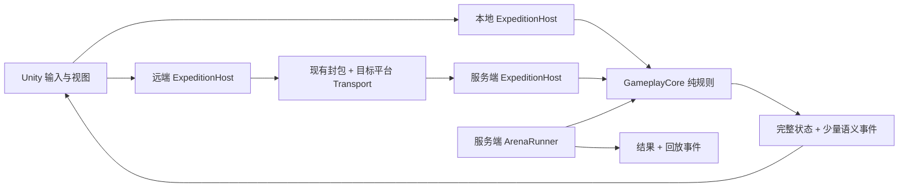

# 百炼 Like 技术先行落地方案

目标读者：AI。

## 1. 文档定位

- 文档状态：2026-08-02 工程收口版。P0–T6、在线默认入口和本机服务端试玩闭环已实现；本地真实
  Server/MongoDB/Robot 已完成远征与 Arena 验证。人工手感、目标设备、正式微信、弱网、MongoDB 故障、
  Linux/生产容量和正式 IP 内容仍未验收，不能把工程完成写成产品门禁通过。
- 完整交付与项目审核见 [2026-08-02 百炼 Like 技术先行完整交付报告](./2026-08-02百炼Like技术先行完整交付报告.md)。
- 目标项目：`game1`；先完成《异界迷宫》，再以同一核心交付《奥特·宇宙军团》。
- 本方案替代此前“先造完整确定性仿真平台、分片调度和增量同步，再做可玩版本”的技术顺序。
- 产品目标与业务取舍仍以中枢 `projects/game1/docs/百炼Like改造调研与双项目交付方案.md` 为准；其中的
  2026-07-27 工程现场只是历史基线，当前工程事实以本文、当前代码和 `projects/game1/line-kb/` 为准。
- 旧 2.5D RPG 已确定放弃。新方案不迁移、不兼容、不包装旧玩法，也不把旧玩法清理计入首个可玩闭环。
- 本文只定义技术落地路径，本身不构成代码、配置、协议、场景、资源、数据库或 Git 提交授权；每个阶段仍以负责人当次明确指令为准。

核心结论：工程链已按最小本地玩法、服务端权威、容量探针、异步 PvP 和第二产品隔离顺序闭合；产品手感、
目标设备与真实外部环境仍按各自门禁验收。当前 50 局进程内探针没有提供增加分片、增量同步或编排设施的证据。

## 2. 调研如何改变原方案

### 2.1 本地报告结论

本次重新核对了：

- 中枢 `docs/CSharp网络游戏服务端调研报告.md`
- 中枢 `docs/Veloren调研报告.md`
- 中枢 `docs/开源游戏调研报告.md`

可直接采用的共同结论：

1. 不存在适合所有玩法的通用游戏服务端；账号、日志、配置等可以共享，局内规则必须围绕真实玩法建立。
2. 一局由一个写入者顺序推进即可；“单局隔离”不等于首版必须有线程分片、集群和调度平台。
3. 单机和联网应尽量复用同一规则路径，但首个手感切片不需要真的经过网络或启动独立本地服务器。
4. 规则与 Unity 表现分离有长期价值；ECS、插件系统、跨平台回滚和世界级模拟没有首期证据。
5. 可借鉴 Mindustry、OpenRA、Veloren 的边界设计，不复制其 GPL 代码，也不复制其产品规模。

### 2.2 成熟商业工程的取舍依据

| 工程/产品 | 已验证经验 | 本项目采用 | 本项目暂不采用 |
| --- | --- | --- | --- |
| Supercell Titan | 面向移动和低端设备；共享引擎从真实游戏代码中逐步提取；快速局长要求关注启动耗时 | 先完成游戏切片，第二个真实消费者出现后再提取接口；从 P0 记录首次可操作时间和低端设备数据 | 先造“公司级游戏引擎” |
| Photon Fusion | Dedicated Server 权威最强但有实例成本；Single/Host/Server 是不同成本与信任模型 | 本地宿主用于快速手感，正式经济闭环用服务端权威 | 把客户端 Host 当作正式经济权威 |
| Nakama authoritative match | 单局状态隔离、固定 Tick、选择最低可接受 Tick、限制每 Tick 消息和发送队列 | 一局一个 `ExpeditionRun`、规则单写者、低 Tick 起步、状态合并和有界队列 | 未压测先做多线程分片或 1,000 局目标 |
| Photon Quantum | 跨平台确定性、预测、回滚和固定点形成一整套专用体系 | 只保留固定 Tick、显式种子和同版本可重复测试 | T0 自研固定点、跨平台校验和、回滚框架 |
| Unity Netcode 选型 | 大规模高复杂度才偏向 Entities；小规模对象玩法可使用更轻方案 | 普通 C# 领域对象和 Unity 视图 | 为单人 PvE 局内引入 DOTS/ECS |
| Agones | 面向 Kubernetes 上的大规模专用游戏服编排 | 达到真实多进程部署需求后再评估 | 首个 Demo 上 Kubernetes/Agones |

本项目吸收的是这些工程的决策逻辑，不引入 Photon、Nakama、Quantum 或 Agones 作为首版依赖。

## 3. 首个验证对象

### 3.1 手感切片，不是系统目录

第一个可玩检查点按当前校准应在累计 Codex 有效工时 22–38 小时内出现，包含 P0、T0 和 T1：

具体执行入口为 [T1 阶段实施计划](./T1阶段实施计划.md)。

`进入灰盒区域 -> 单指带队移动 -> 靠近自动战斗 -> 靠近自动采集 -> 躲一次 Boss 提示 -> 返回并看到结算`

最小内容：

- 竖屏 9:16 灰盒和固定斜俯视镜头；若 P0 锁定其他方向，以 P0 结论为准。
- 1 名主角 + 2 名伙伴；伙伴只需证明跟随、自动目标和回位。
- 1 条短路线、1 组普通敌人、1 个资源节点、1 个 Boss 行为和 1 个出口。
- 2–3 分钟一局；这是手感检查点，不是正式局长。
- 不需要登录、数据库、重连、正式配置表、正式资源或第二产品。

该检查点的通过条件不是“代码能运行”，而是以下行为可被直接试玩：

1. 移动立即响应，队友不会持续互相卡住或明显掉队。
2. 敌人与资源同时出现时，自动目标不会每帧抖动。
3. Boss 仍要求玩家走位，自动战斗没有消灭操作价值。
4. 攻击、采集、掉落和结算反馈可辨认。

### 3.2 完整《异界迷宫》技术竖切

具体执行入口为 [T2 阶段实施计划](./T2阶段实施计划.md)。

手感通过后才扩到：

`编队 -> 6–10 房间探索 -> 战斗/采集/路线提示 -> Boss/撤离 -> 带回资源 -> 升级 1 个基地设施 -> 第二次进入`

- 目标局长 8–12 分钟，以试玩数据调整。
- Zero 只做规则驱动的导航、危险提示和剧情载体，不接大模型。
- 只做 1 条永久升级链；“完成升级并开始第二局”是闭环门禁。
- 社交、正式付费、批量关卡、多个基地设施和小游戏不进入技术先行版本。

## 4. 平台先行：P0

小游戏平台会改变网络、资源和 AOT 边界，不能到客户端完成后再决定。

默认按微信小游戏执行 P0；负责人明确改为 Android/iOS 原生时，替换为相应原生真机冒烟。P0 预计 Codex 有效工时 4–8 小时，执行与记录入口为 [P0 平台冒烟实施与记录](./P0平台冒烟实施与记录.md)。

微信小游戏 P0 只验证五件事：

1. 使用项目精确 Unity 版本和微信官方转换 SDK 导出最小场景。
2. 在开发者工具或目标设备进入场景并记录首次可操作时间、内存和构建/包体数据。
3. 完成一次平台二进制 echo；不直接运行 WebGL 不支持的 `.NET System.Net` socket。微信 P0 用官方 `WX.CreateTCPSocket()` 连接同局域网受控 echo；平台无关传输契约已经落地，正式 WebSocket/WSS 或第二小游戏平台适配由 `GAME1-PLATFORM-05` 跟踪。
4. 完成一个现有 Protobuf 消息的 AOT/裁剪后编码解码。
5. 完成一份配置的异步读取，禁止以同步 `StreamingAssets` 读取冒充平台通过。

2026-07-29 已在微信开发者工具和 iPhone 14 Pro（iOS 17.6.1、微信 8.0.75）完成上述门禁：官方平台 TCP 在同一 Wi-Fi 网段完成 20/20 二进制 echo，真机输出 `P0_READY` 和 `P0_STABLE_60S`。2026-08-01 已把正式传输和正式配置链迁入工程；正式微信登录/RPC/推送/断线重连及性能基线仍需目标设备复验。

P0 不实现业务网关、登录重写、资源热更和 SDK 全能力。任一验证失败时先修平台最短链路，不进入大量玩法制作。

## 5. 轻量目标架构



图中的两种宿主均已有真实消费者：T1/T2 的 `LocalExpeditionHost` 直接推进规则，T3/T4 的服务端
`ExpeditionRunHost` 通过窄映射调用同一 `GameplayCore`。这不是通用仿真平台；协议 DTO 与规则模型仍显式映射。

### 5.1 `GameplayCore` 是什么

它是很小的玩法规则程序集，不是通用 Simulation 平台：

`当前状态 + 本 Tick 命令 + 小型配置 + 可选种子 -> 下一状态 + 玩法事件`

它负责队伍逻辑位置、目标选择、自动战斗、采集、房间状态和结算前局内结果。它不知道 Unity、网络、MongoDB、文件、墙钟、全局单例或服务端组件。

建议物理源码位于 `client/Assets/Scripts/GameplayCore/`，供 Unity 直接编译；`gameplay-core/GameplayCore.csproj` 链接同一份源码供 Server 和 .NET 测试使用。不得复制两份规则源码。

### 5.2 为什么不引用整个 `Shared`

当前 `Shared` 同时承载 Protobuf、网络公共代码和多类跨端工具。让规则程序集引用整个 `Shared`，会把网络 DTO、序列化和其他基础设施变成隐式可用依赖，纯规则边界只剩目录约定。

因此新依赖方向固定为：

```text
GameplayCore -> .NET/netstandard 基础库（无项目引用）
Shared       -> 现有协议和基础设施
Server       -> Shared + GameplayCore，并显式映射协议 DTO 与规则命令/状态
Unity View   -> GameplayCore 的展示所需状态；不修改权威结算
```

只有至少两个真实模块需要同一个小类型且复制已经发生时，才把该类型提取到新的窄契约程序集；不得把 `GameplayCore` 改为引用整个 `Shared`。

### 5.3 首版数值与确定性边界

- 规则以整数 Tick 推进，不读取墙钟；服务端从 10 Hz 起测，手感不足时按 10/15/20 Hz 小步上调。
- 位置和速度首版可使用 `float`。正式胜负和收益只由同一服务端进程计算，客户端浮点误差不参与结算。
- 随机内容需要显式服务端种子和最小自有随机算法；同一构建、配置、种子和命令流必须可重复。
- 不承诺不同 Unity/.NET/CPU 长期重演得到逐位相同结果，也不让客户端用重演证明胜负。
- PvP 由服务端一次算完并保存结果/事件，首版同样不需要 Quantum 式跨平台固定点和回滚。
- 若后续出现“跨版本历史录像必须重新模拟”或“客户端参与锁步”的真实需求，再立专项评估固定点、版本保留和校验和。

## 6. PvE 同步

### 6.1 T1 本地模式

- `LocalExpeditionHost` 在进程内直接推进 `GameplayCore`，Unity 每帧渲染并插值。
- 本地模式只用于快速验证手感和内容闭环，不作为正式奖励权威。
- 不为了形式统一让本地模式经过 loopback socket、RPC 或独立 Server 进程。

### 6.2 T3 在线模式

正式在线 PvE 使用服务端权威：

- 客户端只提交量化移动方向、交互目标和单调输入序号，不提交位置、伤害、掉落或结果。
- 一个 `ExpeditionRun` 由一个服务端宿主顺序调用 `ExpeditionSimulation.Advance`；先挂在现有服务进程的单一
  调度点，不建仿真分片。
- 首版下行完整小快照，频率从 5–10 Hz 起测；不做基线、delta、回滚缓冲和复杂兴趣管理。
- 客户端保留最近权威位置和未确认输入，只预测队伍根移动；敌人、掉落和结算只表现服务端结果。
- 小偏差平滑纠正；越墙、过门和状态切换等硬不变量立即纠正。
- 输入以方向改变立即发送、持续移动低频保活为主；不得每帧创建等待响应的 RPC。
- 每连接发送队列有上限；普通状态只保留最新一份，结算和关键事件走当前 TCP 连接内可靠有序消息。

2026-08-02 最终参数与入口：

- 服务端固定 10 Hz 推进，每 2 Tick 发送一次完整快照，即 5 Hz；普通快照使用 `SendLatest` 替换未发旧状态。
- 每局由单个 `ExpeditionRunHost` 顺序推进；输入每秒最多接受 30 条，最近有效输入 500 ms 后自动归零。
- 客户端 `ExpeditionController` 保存最近快照、未确认输入和队伍根预测；方向变化立即发送，持续输入按 200 ms 保活。
- `InteractionTargetId` 已进入协议、服务端校验和规则目标选择；附近敌人威胁优先于显式资源目标，非法或过远目标回退到自动选择。
- 正式网络以 `IByteTransport` 隔离 Socket 与微信 `WXTCPSocket`，可靠消息使用 1 MiB 有界队列，普通快照只保留最新一份。
- 快照携带 Tick/移动/边界等规则参数，Boss 警告半径、升级价/上限/伤害和进度均来自权威服务端；
  `ExpeditionEventBatchNtf` 承载当前连接内可靠表现事件，断线跨连接 ACK/重放尚未实现。
- `OnlineTechnicalScene` 位于 Build Settings index 0；登录、创建/选择角色后直接进入在线远征世界，不再导航旧
  `GameScene`。T2、T6、T1 本地场景依次位于 index 1、2、3，Arena 收入诊断抽屉。

首版只同步当前房间必要对象。伙伴的视觉跟随和局部避让可以在客户端表现，射程、目标、死亡和收益仍由服务端规则决定。

### 6.3 从完整快照升级的触发条件

只有真实设备测量同时满足以下任一情况，才设计增量快照：

- 单玩家下行超过已确认的平台预算；
- 编解码或 GC 已成为帧时间主要来源；
- 完整快照导致可感知排队或弱网丢弃；
- 当前房间实体数的真实上限使包体不可接受。

升级前保留完整快照作为入局、重连和诊断基线。

## 7. PvE 反作弊

首版反作弊的目标是让客户端没有提交收益的能力，不是建立复杂风控平台。

| 风险 | 最小服务端边界 |
| --- | --- |
| 加速、瞬移、穿墙 | 只接收方向；按服务端 Tick、速度、碰撞和门状态积分位置 |
| 伪造伤害、无敌、无冷却 | 目标、冷却、伤害、死亡全由 `GameplayCore` 推进 |
| 伪造采集、掉落和开图 | 服务端保存资源、房间和揭示状态；未揭示内容不下发 |
| 高频/重放输入 | 校验会话、实例、单调序号、频率和允许状态；非法命令丢弃并计数 |
| 断线重刷 | 同一账号只有一个活跃实例；同进程恢复同一实例和种子 |
| 重复结算 | 实例只能从 Running 一次进入终态；重复请求返回原结果 |
| 修改本地时间 | Tick、冷却和局内时限均不读取客户端时间 |

实施顺序：

1. T3 先实现权威输入和内存中的唯一终态。
2. T4 接永久资产时，再加入持久化幂等键和“先扣后加”结算。
3. 首轮只记录拒绝原因、序号和实例，不做设备指纹、封禁、机器学习和复杂风险分。

局内每 Tick 状态不写数据库。结算先校验并消费本局结算权，再增加服务端奖励，最后交给现有玩家聚合保存边界。

当前实现补充：

- 同一账号同一时刻最多一个活动远征；断线后同进程保留 5 分钟，期间以零输入继续推进，重连恢复同一 Run/Seed。
- 重连令牌为进程内角色令牌：在线不计时且不可消费，权威断线后开启 5 分钟恢复窗，首次消费轮换；
  Reconnect 响应丢失只幂等返回同一新 token，pending EnterGame 成功后才提交。登录签名 Token 与其职责分离。
- 结算回执、带回资源、设施等级和最近结算设施等级进入 `PlayerEntity` 聚合保存；重复结算返回原回执。
- 活动局本身不跨进程恢复，MongoDB 崩溃/重启和真实弱网仍属于外部验证门禁。

## 8. 异步 PvP

PvP 在 PvE 战斗规则和服务端快照稳定后实施，定义保持不变：对战其他玩家的数据副本，双方全自动，战斗中不可操作。

最小链路：

`读取进攻方实时战斗快照 + 防守方已发布快照 -> 分配 BattleId/RequestId/Seed -> 同一服务端批量运行 GameplayCore -> 保存结果和有限语义事件 -> 客户端播放`

首版边界：

- 防守副本只包含单位、成长、技能、站位和规则版本，不包含背包、货币或账号私有数据。
- 客户端不能提交属性、种子、胜负和奖励；播放、倍速、跳过和断线均不改变结果。
- 同一 `RequestId` 只生成一次战斗；重复请求返回已有 `BattleId` 和结果。
- 首轮可在同一服务进程同步或有界串行队列中运行，不建独立竞技场集群。
- 回放先保存“关键状态 + 少量语义事件”；不承诺通过客户端重新模拟恢复结果。
- 只做 1 个固定对手副本、1 场战斗和内存结果；赛季、排行、匹配池、跨服和长期录像不在技术证明内。

2026-08-01 已实现固定防守副本、服务端分配 `BattleId`/Seed、按角色与 `RequestId` 幂等、一次性批量规则运行、
有限关键帧/语义事件回放，以及客户端 1 倍、4 倍和跳过播放。完整回放最多保留 128 场、保留 5 分钟；幂等回执
最多全局 4096 条、每角色 64 条、保留 10 分钟。回放淘汰后仍在幂等窗口内返回原胜负摘要，但 Arena 结果不写数据库，
不具备赛季、排行、奖励或长期录像语义。

## 9. 分阶段实施

以下为 Codex 有效工时，包含调查、实现、验证和收尾；已由负责人复核的阶段写实际值，其余为预计值。不包含正式美术、动画、音频、IP 审批、渠道审核和人工试玩等待。

| 阶段 | 工程实现 | 自动化证据 | 仍未通过的产品/外部门禁 |
| --- | --- | --- | --- |
| [P0](./P0平台冒烟实施与记录.md) | 历史隔离冒烟通过；正式传输与配置链已迁入 | 历史工具/真机 20/20；当前托管与 Unity 编译 | 正式微信业务链与当前 WebGL/IL2CPP 复验 |
| [T0](./T0阶段实施计划.md) | 同源窄 `GameplayCore`，后续已扩展真实房间与 Arena 规则 | 边界脚本与 .NET 行为测试 | 无新增产品门禁；历史结论保留 |
| [T1](./T1阶段实施计划.md) | 2–3 分钟本地灰盒行为闭合 | 纯规则与 PlayMode | 9:16 手感、三局、10/15/20 Hz、目标设备 |
| [T2](./T2阶段实施计划.md) | 房间、结算、升级、失败恢复和第二局闭合 | Golden Seed、256 Seed 与 PlayMode | 8–12 分钟、路线/升级体验、前后台与目标设备 |
| T3 | 服务端权威、完整快照、预测纠正和正式 Transport | 协议、宿主、伪造输入拒绝、客户端状态消费 | 正式微信登录/RPC/推送/重连跑完一局 |
| T4 | 同进程重连、唯一结算、持久进度与容量探针 | 1/10/50 局探针；真实 Server/MongoDB/Robot 完整远征 | MongoDB 故障/重启、弱网、Linux/生产容量 |
| T5 | 固定对手异步 PvP、幂等摘要与有限回放 | 10,000 次同构建哈希、容量/回放测试及真实 Arena Robot | Unity 人工联机播放；长期持久化/赛季不在范围 |
| T6 | 两个中性 Profile、主题/内容隔离、180 秒规则接入真实远征终局 | 本地与 Server 共用 ProductExpedition；真实场景 PlayMode | 目标环境、人工体验、正式 IP 资产与业务验收 |

原预计总量 75–131 Codex 有效工时只作为历史规模口径，不等于产品门禁或商业上线版本已经完成。

时间检查点：

- 22–38 小时：目标平台可运行，出现首个可玩手感切片。
- 43–75 小时：完整《异界迷宫》小闭环进入服务端权威。
- 75–131 小时：弱网、最小 PvP 和第二产品隔离都有证据。

任一阶段的产品门禁失败，优先改玩法或缩内容；不得以增加基础设施掩盖手感问题。

### 9.1 预计改动范围

下表保留各阶段的实施范围；当前实际入口和验证边界以 `docs/模块文档/`、`docs/测试列表.md` 与
中枢 `docs/工作记录/2026-08.1/2026-08-02.md` 为准。

| 阶段 | 主要新增/修改范围 | 不进入该阶段的范围 |
| --- | --- | --- |
| P0 | `client` 的目标平台导出、最小 Transport/配置读取验证和冒烟记录 | 完整登录重写、资源热更、业务协议 |
| T0 | `GameplayCore` 同源程序集、独立测试、边界脚本和 solution/check-all 接入 | Shared、Server、旧玩法和 Unity 场景 |
| T1 | `GameplayCore` 的队伍/目标/战斗/采集最小规则，以及新的 Expedition Logic/View 灰盒入口 | 网络、数据库、正式资源 |
| T2 | 房间图、Boss/撤离、局内资源、一个基地升级和第二局的本地数据 | 多基地、多关卡、完整养成 |
| T3 | 新 Expedition 协议、Server Session、客户端远端宿主和目标平台联机适配 | 分片、增量快照、跨进程恢复 |
| T4 | 玩家永久状态与唯一结算、Robot/弱网用例、容量脚本和运行记录 | 生产编排、复杂风控 |
| T5 | Arena 数据副本、批量 Runner、结果/回放协议和幂等测试 | 赛季、排行、跨服、长期录像 |
| T6 | 两个产品配置/内容入口、一条第二产品专属规则和主题冒烟 | 通用插件市场或复制第二套核心 |

旧 RPG 文件不属于上述任何阶段。本轮授权已用于屏蔽默认入口；物理删除必须按 `GAME1-MIGRATION-01` 先完成
消费者与共享依赖清单、精确文件清单和引用为零证据，不能连带删除登录、Session、封包、配置和玩家聚合设施。

### 9.2 本机联机测试入口

Unity Editor 菜单 `Tools/Online Technical/Build, Start Server and Play` 已实现构建、仅 loopback 启动、打开在线
场景和 Play；窗口同时提供状态、日志与安全停止。停止路径通过 PID、Unity 父进程、启动时间、token 与控制文件
限定所有权，优雅停服等待上限为 20 秒；启动就绪的监听归属握手仍由 `GAME1-ENG-12` 跟踪。正式 Player 不携带
服务端；自动 MongoDB、跨平台桌面编排和测试 Player 伴随服务由 `GAME1-ENG-10` 跟踪。

### 9.3 新增项目审核结论

`GameplayCore`、`ProductContent`、`ProductExpedition` 是规则、内容、组合的永久产品边界；对应 Unity `asmdef`
与 .NET `.csproj` 编译同一物理源码。`Client.Expedition`、`Client.ProductProfile`、
`Client.Expedition.Editor`、`Client.Expedition.WeChat` 分别隔离玩法表现、主题、Editor 工具和微信平台依赖，
`Client.Expedition.PlayMode` 只承载 Unity 回归；它们都是永久边界。Shared/ProductContent/Server 测试项目也是
永久测试边界。Unity 自动生成的 `client/*.csproj` 是忽略投影，`cosmic_legion_placeholder` 是临时内容而非项目。
本轮没有缺乏独立职责、需要合并或删除的尖峰项目；逐项消费者和理由见最终交付报告第 5 节。

## 10. 容量与扩展触发器

T4 只跑 1、10、50 个逻辑实例，记录：

- 单局常驻内存和每 Tick 分配；
- Tick P50/P95/P99 和积压；
- 单玩家上下行字节、快照大小和发送队列峰值；
- 权威纠正次数/距离、断线恢复和拒绝命令；
- PvP 单场耗时、事件数和结果大小。

扩展规则：

1. 50 局满足预算：继续单进程，不做分片。
2. 单写者 Tick 超预算且规则优化无效：固定数量 worker，每局仍只属于一个 worker。
3. 单机容量和真实 CCU 证明需要多进程：再设计实例路由和进程间恢复。
4. 已有容器化专用服且人工调度成为问题：再评估 Agones/Kubernetes。

不得把“以后可能很多玩家”当作提前建设上述层级的证据。

2026-08-01 进程内确定性容量探针（不是 TCP、客户端、数据库、Linux 或生产 CCU 测试）：

| 并发逻辑局 | Tick P50/P95/P99 | 常驻近似 | 每 Tick 分配近似 | 最大快照/包 | 估算下行/局 |
| ---: | --- | ---: | ---: | --- | ---: |
| 1 | `0.005/0.023/0.438 ms` | `6384 B/run` | `13207 B/runTick` | `328/356 B` | `889.6 B/s` |
| 10 | `0.005/0.060/0.088 ms` | `4764 B/run` | `1139 B/runTick` | `328/356 B` | `870.8 B/s` |
| 50 | `0.024/0.317/0.404 ms` | `4648 B/run` | `1130 B/runTick` | `328/356 B` | `850.1 B/s` |

三档均无 100 ms Tick 超预算。该证据只支持“当前探针无需分片”；不支持真实带宽、GC 峰值或生产容量结论。

## 11. 第二产品边界

《奥特·宇宙军团》按“共享核心 + 产品内容 + 少量专属规则”交付，不复制仓库，也不先造插件平台。

- T1–T5 使用中性业务名，禁止把 Zero、奥特、光之因子等品牌词写入 `GameplayCore` 基础概念。
- T6 在有两个真实配置后才形成最小 `ProductProfile`。
- 角色、敌人、资源、UI 和场景主要换皮。
- 3 分钟倒计时、信标净化、形态/羁绊等不是美术皮肤；按独立小规则和配置实现。
- 只有第三个真实规则模块出现重复接入代码时，才考虑规则插件注册机制。

T6 当前只使用 `labyrinth` 与 `cosmic_legion_placeholder` 两个中性 Profile，分别提供独立内容 ID、主题 token 和
占位单位数据。无依赖的 `ProductContent` 保存内容/规则配置，`ProductExpedition` 窄组合层在每局构造时固定产品；
本地宿主与 Server 都消费同一 `ProductExpeditionFactory`。第二 Profile 在 10 Hz 第 1800 Tick 通过产品中立失败
入口结束真实远征并进入唯一结算，首作不受时限影响。真实 T6 场景同时把第二 Profile 的主题应用到远征世界相机。
正式奥特角色、美术、音频、授权和渠道内容尚未交付。

## 12. 明确不做与重新评估条件

技术先行版本不做：

- 旧 RPG 兼容、迁移和旧玩法重构；
- 完整固定点数学库、预测回滚和跨平台逐位确定性；
- 增量快照、通用 AOI、每局线程、分片集群和跨进程热迁移；
- DOTS/ECS、通用技能编辑器、规则插件平台和第二套共享框架；
- Kubernetes、Agones、Orleans、微服务拆分和分布式事务；
- 完整赛季、排行榜、社交、商业化和风控后台。

以下真实需求出现时另立方案，不在当前阶段顺手加入：

- 客户端参与锁步或必须跨平台重模拟历史战斗；
- 完整快照经测量超预算；
- 50 局压力数据证明单进程调度不足；
- 产品确认离线 PvE，导致客户端必须持有完整规则和隐藏地图；
- PvP 要求攻守双方即时改分或跨服一致结算；
- 第二、第三产品规则差异已经形成真实重复代码。

## 13. 每阶段执行与报告规则

实施任一阶段前：

1. 重新读取项目档案，确认真实路径、Git 根和 origin。
2. 记录分支、HEAD、`git status --short`、暂存区和进行中的 Git 操作。
3. 列出本阶段唯一允许修改的文件；发现归属不明的重叠改动立即停止。
4. 只验证本阶段声明的行为，不把编译、静态护栏或 Robot 输出冒充真机和试玩结果。

每阶段最终报告必须包含：

- 实际变更文件及其职责；
- 真实运行证据、设备/环境和指标；
- 未执行验证与原因；
- 是否通过本阶段产品门禁；
- 计划外 Git 变化检查；
- 下一阶段是否仍值得进入，而不是默认继续扩张。

## 14. 调研依据

- [Supercell：The Engine Behind Every Supercell Game](https://supercell.com/en/news/game-engine-called-titan/)
- [Supercell：How Titan Made Brawl Stars Toilet Break-Friendly](https://supercell.com/en/news/titan-game-engine/)
- [Photon Fusion：Network Topologies](https://doc.photonengine.com/fusion/current/manual/network-topologies)
- [Nakama：Authoritative Multiplayer](https://heroiclabs.com/docs/nakama/concepts/multiplayer/authoritative/)
- [Photon Quantum：Frames](https://doc.photonengine.com/quantum/current/manual/frames)
- [Photon Quantum：Fixed Point](https://doc.photonengine.com/quantum/v2/manual/quantum-ecs/fixed-point/)
- [Unity：Netcode solution choices](https://docs.unity.com/en-us/multiplayer/netcode/netcode)
- [Unity：WebGL networking](https://docs.unity.cn/Manual/webgl-networking.html)
- [微信小游戏 Unity/团结转换 SDK](https://github.com/wechat-miniprogram/minigame-tuanjie-transform-sdk)
- [Agones：Overview](https://agones.dev/site/docs/overview/)
