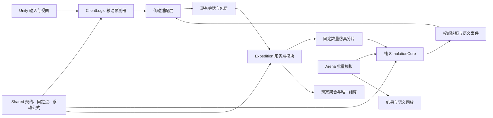

# 百炼 Like 技术先行落地方案

目标读者：AI。

## 1. 状态与执行边界

- 文档状态：可执行方案，尚未开始代码实施。
- 目标项目：`game1`，先交付“异界迷宫”，后续“Ultra Cosmic Legion”只复用技术底座并换主题包装。
- 当前授权仅覆盖本文档的创建与维护，不授权修改代码、配置、协议、数值表、Unity 场景、服务端数据或 MongoDB。
- 本文中的命令是后续验证入口，不构成当前执行授权。
- 开始任一实施阶段前，必须重新检查分支、`git status --short`、目标文件和并行修改归属；计划文件存在归属不明的改动时停止并报告。
- 当前 RPG 玩法确定放弃。不得为了兼容旧玩法扩大新架构，不迁移旧玩法协议、数值和存档语义。
- 基础设施可以复用，旧玩法只能在编译迁移期短暂共存；新模块不得调用旧 `Map`、`Fight`、`Monster`、PK 或角色属性玩法逻辑。

## 2. 已确认边界

### 2.1 产品边界

1. 优先做“异界迷宫”的在线 PvE 技术竖切。
2. PvE 同步、PvE 反作弊、异步 PvP 和改动范围是平行设计项，不能拿 PvP 方案代替 PvE 方案。
3. PvP 对手是其他玩家的数据副本；攻守双方全自动战斗，战斗中不可操作。
4. “Ultra Cosmic Legion”后期使用同一战斗、编队、成长、关卡和网络底座，通过主题资源、配置和 UI 包装交付。
5. 旧 2.5D RPG 不承担兼容目标，也不作为新模块的渐进演化方向。

### 2.2 技术先行阶段的默认值

以下数值用于尽快得到可测结果，不是最终策划定案：

| 项目 | 技术先行默认值 | 调整门槛 |
| --- | --- | --- |
| PvE 在线条件 | 关卡进行期间保持在线 | 若改为可离线游玩，必须重新设计权威边界和存档签名 |
| 服务端逻辑帧 | 20 Hz | 压测或战斗手感证明成本不合适时再调整 |
| 客户端输入发送 | 10–20 Hz，可合批 | 以弱网和包量结果为准 |
| 服务端状态下发 | 5–10 Hz，关键事件立即下发 | 以纠偏观感和带宽结果为准 |
| 编队 | 1 名主角 + 2 名伙伴 | 核心数据结构至少支持 5 个单位 |
| 活跃远征 | 每名玩家最多 1 个 | 先保证重连、重复请求和结算边界清晰 |
| 技术竖切时长 | 8–12 分钟 | 只用于覆盖完整循环，不代表正式局长 |
| 传输层 | 先用现有 TCP 完成局域网证明 | 客户端接口必须隔离传输，目标平台确定后再评估 WebSocket |
| 首版故障恢复 | 同一服务进程内断线重连 | 跨进程恢复、热迁移和灾难恢复不在首轮证明内 |

## 3. 技术先行目标

### 3.1 PvE 竖切

交付一条 8–12 分钟的灰盒在线闭环：

`创建远征 -> 移动编队 -> 房间揭示 -> 自动战斗 -> 采集/开门 -> Boss -> 主动退出或胜利 -> 唯一结算`

闭环必须同时证明：

- 服务端权威连续模拟可以运行，客户端只预测可操作移动并接受纠偏。
- 地图、敌人、掉落、资源交互和结算不能由客户端决定。
- 同一输入、种子、配置和仿真版本得到一致结果。
- 断线后能够恢复当前权威快照，重复输入和重复结算不产生额外收益。
- 一个进程内能够承载多局并发，且有 CPU、内存、逻辑帧、GC 和网络包量证据。

### 3.2 异步 PvP 技术证明

使用与 PvE 相同的纯战斗内核，交付以下最小链路：

`读取双方战斗快照 -> 服务端分配 BattleId/Seed -> 离线批量模拟 -> 生成结果与语义事件 -> 客户端播放回放`

本阶段不做完整匹配、赛季、排行、奖励、跨服和正式 PvP UI。

## 4. 明确不做

- 不迁移或兼容旧 RPG 地图、战斗、怪物、PK、角色属性、任务和 UI 玩法。
- 不制作正式美术、音效、剧情和批量关卡内容。
- 不扩张主城、社交、公会、商业化和完整养成系统。
- 不实现离线 PvE、客户端自验证结算或客户端上传完整战斗结果。
- 不实现 PvP 赛季、积分、匹配池、排行榜、跨服和永久回放仓库。
- 不实现跨进程远征恢复、分布式事务和正式生产容灾。
- 不在目标平台未确定前投入商业级 WebSocket、网关和平台 SDK 适配。
- 不因后续换皮提前复制第二套逻辑；换皮差异只能从配置、资源和展示层进入。

## 5. 当前工程事实与改动边界

当前工程已经具备 Unity 客户端、`ClientLogic`、`Shared`、TCP 会话、包编解码、RPC、玩家聚合和服务端保存机制。服务端当前主要由单个 `GameSynchronizationContext` 驱动，旧战斗依赖全局随机与墙钟时间，不能直接承担确定性多局仿真。

| 当前能力或模块 | 处理方式 | 边界 |
| --- | --- | --- |
| 用户身份、登录、会话、RPC、包编解码、日志、配置加载 | 评估后复用 | 只复用基础设施语义，不继承旧玩法协议 |
| `Player` 聚合与既有合批保存机制 | 复用保存边界 | 局内每帧状态不写 DB；结算后才写长期资产 |
| `Shared` 跨端代码编译方式 | 复用 | 仅放协议原语、固定点、输入/快照 DTO 和可预测移动公式 |
| `Map`、`Fight`、`Monster`、PK、旧角色属性 | 替换 | 新远征和竞技场模块禁止依赖这些旧玩法模块 |
| 旧玩法协议和配置表 | 新建平行命名空间 | 不复用旧 tag 语义，不做兼容映射 |
| 当前单主线程全局 Tick | 保留为业务汇合线程 | 不直接承载所有局内连续仿真 |
| Unity `MonoBehaviour` | 只负责视图、输入采集和生命周期 | 不放权威规则、结算或随机逻辑 |

## 6. 目标架构



### 6.1 拟新增代码边界

以下路径是实施目标，创建前仍需代码写入授权：

```text
client/Assets/Scripts/shared/Simulation/
  Primitives/         # Tick、版本、固定点、稳定 ID
  Contracts/          # 输入、快照、事件和结算 DTO
  Prediction/         # 客户端和服务端共用的编队根节点移动公式

simulation/
  Simulation.csproj   # netstandard2.1，引用 Shared
  Core/               # 固定帧、确定性随机、状态容器
  Combat/             # 自动选目标、技能、伤害、Buff、死亡
  Expedition/         # 房间图、揭示、交互、Boss、退出状态机
  Replay/             # 语义事件和结果摘要

tests/Simulation.Tests/
  Simulation.Tests.csproj
  Determinism/
  Combat/
  Expedition/
  Security/

server/Components/Expedition/
  ExpeditionComponent.cs
  ExpeditionScheduler.cs
  ExpeditionShard.cs
  ExpeditionSettlement.cs

server/Components/Arena/
  ArenaComponent.cs
  ArenaBattleRunner.cs

client/Assets/Scripts/Logic/Expedition/
  ExpeditionSession.cs
  ExpeditionPredictor.cs
  ExpeditionReconciler.cs

client/Assets/Scripts/View/Expedition/
  # 灰盒单位、镜头、动画、房间和 HUD；不得包含权威规则

client/Assets/Scripts/shared/Protocol/
  ExpeditionProtos.cs
  ArenaProtos.cs
```

### 6.2 强制依赖方向

1. `Shared` 不引用 Unity、Server、MongoDB、ECS 或墙钟 API。
2. `Simulation` 只引用 `Shared`；不得引用 Unity、Server、MongoDB、网络和文件系统。
3. Server 引用 `Simulation`，负责身份、队列、分片、重连、结算和持久化边界。
4. ClientLogic 只复用 `Shared` 的移动预测公式，不运行隐藏地图、掉落、敌人 AI 和结算规则。
5. View 通过状态和事件渲染，不直接修改仿真状态。
6. Arena 和 Expedition 复用同一个 Combat 内核，不复制伤害、Buff 或 AI 实现。

### 6.3 仿真不变量

- 时间只使用整数 `Tick`，不在规则内读取 `DateTime`、`Stopwatch` 或 Unity `Time`。
- 位置、距离、速度和百分比使用明确单位的整数或版本化固定点，不用浮点数决定权威结果。
- 随机源使用自有、版本化算法；首选 `PCG32 v1`，禁止 `System.Random` 和 Unity 随机源进入规则层。
- 所有迭代顺序必须稳定，不依赖 `Dictionary`、实体查询或线程调度的偶然顺序。
- 配置、地图生成器、AI 和战斗规则都携带版本；回放和结果必须记录版本集合。
- 纯函数输入包含全部决定因素，输出为新状态或显式事件，不读取单例和全局状态。

## 7. PvE 同步方案

### 7.1 权威模型

- 服务端保存完整远征状态并以 20 Hz 推进；客户端不能上传位置、伤害、命中、掉落或结算结果。
- 客户端只上传“意图”：移动方向、目标交互、允许的技能/模式切换，以及单调递增 `InputSequence`。
- 服务端按玩家、连接和远征校验序号、频率、状态和权限，再把输入放入所属仿真分片。
- 服务端状态包包含 `ServerTick`、已确认的 `AckInputSequence`、实体增量和关键语义事件。
- 客户端保存最近一次权威状态及尚未确认的输入；收到权威状态后回滚到该状态，重放未确认输入，再平滑修正视图。
- 战斗、敌人、房间揭示、资源交互和掉落只播放服务端状态/事件，不做客户端结算预测。

### 7.2 网络频率与包策略

| 数据 | 发送方向 | 初始频率 | 策略 |
| --- | --- | --- | --- |
| 移动/交互输入 | Client -> Server | 10–20 Hz | 通知消息，可合批；状态包回传确认序号 |
| 普通实体增量 | Server -> Client | 5–10 Hz | 基于最近已确认基线压缩；超预算时降频而非丢权威事件 |
| 伤亡、房间揭示、拾取、Boss 阶段 | Server -> Client | 事件发生时 | 可靠、有序、带事件序号 |
| 完整快照 | Server -> Client | 入局、重连、失配恢复 | 包含基线 ID、仿真版本和当前 Tick |
| 心跳/网络质量 | 双向 | 低频 | 采集 RTT、抖动、排队时间和断线判定 |

首轮使用现有 TCP 是为了验证业务模型，不代表长期传输决策。TCP 下必须测量队头阻塞；客户端网络层需通过接口隔离，以便目标平台确定后替换为 WebSocket 或其他实现。

### 7.3 重连状态机

远征实例至少具有以下状态：

`Created -> Running -> Frozen -> Settling -> Completed | Failed`

- 连接断开后实例进入有限宽限期，保留在原仿真分片；无人操作时使用明确的“停止移动、继续自动战斗”策略。
- 玩家重连后提交玩家身份和 `ExpeditionId`，服务端验证归属，返回完整权威快照、最后确认输入和事件基线。
- 宽限期结束后的处理必须由产品决定：失败、按已获资源结算、或保留待恢复。T6 前不得自行选择。
- 首版只声明同一服务进程内恢复。进程退出后是否恢复必须另立持久化与恢复方案。

## 8. PvE 反作弊方案

反作弊的核心不是客户端检测，而是客户端没有能力提交权威结果。

| 风险 | 客户端允许提交 | 服务端校验/权威来源 | 拒绝或处理 |
| --- | --- | --- | --- |
| 加速、瞬移 | 方向与输入序号 | 固定 Tick、速度上限、碰撞、状态约束 | 丢弃非法输入，累计风险计数并下发纠偏 |
| 篡改伤害/秒杀 | 无 | 服务端技能、属性、冷却、目标和随机 | 不存在结果上传入口 |
| 无冷却/高频操作 | 技能或模式意图 | 服务端 Tick、冷却和每秒命令预算 | 拒绝并记录命令类型、序号和上下文 |
| 穿墙/提前开图 | 交互目标 ID | 服务端地图图、距离、房间揭示和门状态 | 拒绝；客户端只收到已揭示区域 |
| 伪造拾取/奖励 | 交互意图 | 服务端实体存活、距离、所有权和奖励账本 | 原子消费资源实体，再写临时账本 |
| 重放旧包 | 输入/请求 | 会话、远征 ID、单调序号、有效 Tick 窗口 | 丢弃重复或过期消息 |
| 重连复制收益 | 重连请求 | 唯一远征、权威快照、结算状态 | 返回同一状态，不重新生成实例或奖励 |
| 重复结算 | 退出/结算请求 | `ExpeditionId + SettlementVersion` 唯一键和玩家聚合状态 | 已结算时返回原结果，不再次发奖 |
| 修改本地时间 | 无可信时间 | 服务端 Tick 与服务端墙钟仅用于会话超时 | 客户端时间不参与规则 |
| 抓包窥探地图 | 无 | 服务端按揭示范围裁剪状态 | 未揭示房间、种子和掉落不下发 |

结算必须遵守“先扣后加”：先验证并消费本局结算权和防重复状态，再把服务端奖励账本中的收益写入玩家权威内存对象，最后交给现有合批保存机制。不得为每个 Tick、掉落或房间插入即时 DB 保存。

## 9. 异步 PvP 方案

### 9.1 数据边界

防守快照只保存战斗需要的不可变数据：

- `SnapshotId`、拥有者、仿真/配置/编队版本。
- 单位模板、等级、升阶、装备效果、技能和站位。
- 规则允许的派生属性；禁止携带运行时对象引用和客户端计算结果。
- 快照生成时间和更新原因，用于审计但不参与战斗随机。

开战时服务端完成：

1. 校验攻击方实时战斗快照和防守方已发布快照。
2. 分配唯一 `BattleId`、幂等 `RequestId` 和服务端种子。
3. 在后台批量运行同一 `Simulation.Combat` 内核，不接收战斗中输入。
4. 生成胜负、统计摘要、版本集合和有序语义事件。
5. 对重复 `RequestId` 返回同一结果；不得重复扣次数或发奖励。
6. 客户端按语义事件播放，回放画面不是权威证据。

### 9.2 与 PvE 的复用和隔离

- 复用：单位状态、技能、Buff、伤害、AI、确定性随机、语义事件和结果摘要。
- 隔离：PvE 房间图、玩家输入、移动预测、重连、掉落账本不进入 PvP。
- PvP 结果只由服务端批量模拟产生；客户端不能上传种子、帧日志或胜负。
- 技术证明先保存内存结果和短期事件流，正式历史回放、赛季和奖励另行设计。

## 10. 协议草案

以下名称用于锁定职责，正式实施时再分配稳定协议 tag；不得复用旧 RPG 消息含义。

### 10.1 PvE

| 消息 | 类型 | 用途 |
| --- | --- | --- |
| `ExpeditionStartReq/Ack` | RPC | 校验编队和活跃实例，创建或返回同一远征 |
| `ExpeditionInputNtf` | Client -> Server 通知 | 批量上传输入序号、目标 Tick、移动和交互意图 |
| `ExpeditionStateNtf` | Server -> Client 通知 | 下发增量、事件、服务端 Tick 和确认输入序号 |
| `ExpeditionSnapshotNtf` | Server -> Client 通知 | 入局或失配时下发完整权威基线 |
| `ExpeditionReconnectReq/Ack` | RPC | 验证归属并恢复完整快照与事件基线 |
| `ExpeditionExitReq/Ack` | RPC | 请求退出；只触发服务端状态机，不携带奖励 |
| `ExpeditionResultNtf` | Server -> Client 通知 | 下发唯一结算 ID、摘要和长期资产变化 |

高频输入不得为每一帧创建一个等待响应的 RPC。确认序号随状态通知返回，避免大量 pending request 和超时对象。

### 10.2 异步 PvP

| 消息 | 用途 |
| --- | --- |
| `ArenaDefenseSetReq/Ack` | 服务端校验并发布防守快照 |
| `ArenaOpponentListReq/Ack` | 获取可挑战对象及公开摘要 |
| `ArenaBattleStartReq/Ack` | 幂等创建并运行一次全自动战斗 |
| `ArenaBattleResultNtf` | 返回结果摘要和回放元数据 |
| `ArenaReplayChunkReq/Ack` | 仅在事件流超过单包预算时分页读取 |

## 11. 分阶段实施

所有阶段的工时均为“预计 Codex 有效工时”，包含调查、实现、验证和收尾，不代表自然日。

| 阶段 | 目标 | 预计 Codex 有效工时 | 必须通过的门禁 |
| --- | --- | --- | --- |
| T0 | 基线、项目骨架、契约与版本规则 | 8–12 小时 | 全工程编译、依赖方向检查 |
| T1 | 确定性纯仿真与自动战斗 | 48–80 小时 | 同种子 10,000 次一致，规则层无墙钟/全局随机 |
| T2 | 远征房间、资源、Boss 与退出状态机 | 32–56 小时 | 灰盒无网络闭环和状态机测试通过 |
| T3 | 多局调度与容量压测 | 32–56 小时 | 100/500/1,000 局分档证据和预算结论 |
| T4 | PvE 协议与服务端接入 | 40–72 小时 | 协议护栏、服务端编译、Robot 会话闭环 |
| T5 | 客户端预测、纠偏与灰盒表现 | 48–80 小时 | Unity 实机完整一局及弱网验证 |
| T6 | PvE 反作弊、重连和唯一结算 | 40–72 小时 | 对抗用例、重复结算和重连用例通过 |
| T7 | 异步 PvP 技术证明 | 32–56 小时 | 确定性、幂等、回放体积门禁通过 |
| T8 | 集成验收、旧模块删除清单和文档收口 | 24–40 小时 | 全量护栏、证据清单、未验证项齐全 |
| 合计 | 技术先行，不含正式内容生产 | **304–524 小时** | 任一前置门禁失败均不得进入后续内容扩张 |

### T0：建立可编译边界

前提：取得代码和工程文件写入授权；重新记录分支、HEAD、工作树和并行修改归属。

具体步骤：

1. 新增 `Simulation.csproj` 和测试工程，加入解决方案；若测试框架需要新 NuGet 依赖，先核对项目依赖策略再选择。
2. 在 `Shared` 定义 `SimulationVersion`、`ConfigVersion`、`GeneratorVersion`、`Tick`、固定点、稳定实体 ID、输入序号和事件序号。
3. 定义输入、状态、事件、结果的最小 DTO；只表达数据，不放 Server 或 Unity 行为。
4. 建立依赖护栏，禁止 `Simulation` 引用 Unity、Server、MongoDB、网络、文件系统和墙钟 API。
5. 建立针对 `System.Random`、Unity 随机源、`DateTime` 和非确定性并发的规则层静态护栏。

交付物：可编译空骨架、依赖图、版本契约和测试入口。

门禁：`Shared`、`Simulation`、测试、`ClientLogic`、Server、Robot 全部编译；现有协议和客户端边界检查不回退。

停止条件：项目引用导致 Unity 与 .NET 目标框架无法统一，或必须引入未经决策的新运行时依赖。此时先提交兼容性调查，不继续写业务代码。

### T1：实现确定性 SimulationCore

前提：T0 门禁通过。

具体步骤：

1. 实现版本化 `PCG32 v1` 和固定测试向量；每局只由服务端种子创建随机流。
2. 实现整数 Tick、固定点向量、稳定排序和显式状态容器。
3. 实现单位、技能、冷却、伤害、Buff、死亡和自动选目标的最小规则。
4. 把 AI 写成显式状态机或行为节点；每次决策的输入和输出可记录、可重放。
5. 产生语义事件，例如施法、命中、伤害、死亡和阶段切换；视图不依赖内部对象引用。
6. 编写黄金用例、属性边界、顺序扰动和同种子重复测试。

交付物：不依赖网络和 Unity 的自动战斗内核、事件流和确定性测试集。

门禁：同输入、种子、配置和版本连续运行 10,000 次结果哈希一致；异常数值、平局和最大 Tick 都有明确结果。

停止条件：需要浮点物理、容器非稳定顺序或墙钟才能决定结果。先修改规则模型，不用回放补丁掩盖不确定性。

### T2：实现远征状态机

前提：T1 战斗门禁通过。

具体步骤：

1. 实现由 `Seed + GeneratorVersion + ConfigVersion` 决定的房间图生成器。
2. 实现房间未揭示、已揭示、战斗中、已清理状态及门、资源点、Boss 和出口。
3. 实现 1+2 编队根节点移动、伙伴跟随和自动进入战斗；核心容器支持 5 个单位。
4. 实现采集、拾取和开门的服务端规则，以及仅存在于局内的奖励账本。
5. 实现 `Created/Running/Frozen/Settling/Completed/Failed` 状态机和最大局长保护。
6. 使用纯测试驱动一条无网络灰盒流程：创建、探索、战斗、Boss、退出和结果摘要。

交付物：完全在内存中可重复运行的远征闭环。

门禁：未揭示地图不会出现在对外快照；同种子房间图和结果一致；任意非法状态转换被拒绝。

停止条件：关卡设计必须依赖客户端场景物理或隐藏客户端数据。先把规则数据化，不继续接网络。

### T3：实现多局调度和压测

前提：T2 纯远征闭环通过。

具体步骤：

1. 新建固定数量的 `ExpeditionShard`，每个远征在生命周期内固定归属一个分片。
2. 主业务线程只负责入队、身份、结算汇合和生命周期管理；分片消费命令并连续推进仿真。
3. 禁止每 Tick 或每实例 `Task.Run`，禁止共享可变仿真状态跨分片访问。
4. 建立无 Unity、无网络压测器，分别运行 100、500、1,000 个并发实例。
5. 采集每 Tick 平均/P95/P99 用时、超时局数、CPU、实例内存、分配字节、GC 暂停和队列深度。
6. 根据数据决定 Tick、分片数、休眠实例降频和状态采样策略。

交付物：调度器、压测器、容量报告和可复现命令。

门禁：至少给出目标机器上的分档结果及单局成本，明确当前安全容量；不能只报告“能运行”。

停止条件：P99 持续超过单 Tick 预算，或分配/GC 随局数不可控。先修仿真和调度，不进入客户端内容开发。

### T4：接入 PvE 协议与服务端

前提：T3 已得到可接受的安全容量；目标发布平台至少给出候选范围。

具体步骤：

1. 新增独立 Expedition 协议，冻结消息职责、序号、版本、最大集合长度和单包预算。
2. 实现 Start、Input、State、Snapshot、Reconnect、Exit 和 Result 处理器。
3. Input 处理器只完成身份、频率、序号和状态预检，再把命令送到所属分片。
4. 状态下发实现基线 ID、确认输入序号、增量和完整快照回退。
5. 通过传输接口接入现有 TCP；记录包量、排队时间和队头阻塞，不把 TCP 类型泄漏进 ClientLogic。
6. 扩展 Robot，覆盖登录、建局、输入、状态接收、断线重连和退出。

交付物：服务端在线远征链路和无 Unity 的 Robot 闭环。

门禁：协议检查通过；超长集合、错误版本、乱序/重复输入和越权远征都被拒绝；Robot 能完整跑一局。

停止条件：目标平台明确禁止当前传输方式，或现有包层无法在预算内承载状态流。先完成传输替代决策，不把业务协议绑死在 TCP。

### T5：实现客户端预测、纠偏和灰盒视图

前提：T4 Robot 闭环通过；使用准确 Unity `2022.3.62f3c1` 环境。

具体步骤：

1. ClientLogic 保存最新权威快照、未确认输入和本地预测 Tick。
2. 只对编队根节点移动做预测；收到权威状态后回滚、重放未确认输入并计算误差。
3. 小误差由 View 平滑修正，大误差立即校正并记录原因；权威逻辑不受表现插值影响。
4. 战斗、资源、房间揭示和结算完全由服务端事件驱动表现。
5. 制作 1+2 灰盒单位、房间、Boss、资源点、HUD、网络状态和结果页。
6. 在可控网络注入下测试延迟、抖动、丢包等效阻塞、短断线和恢复。

交付物：Unity 中可操作的完整灰盒一局和弱网证据。

门禁：正常网络无持续抖动；100/200/300 ms RTT 档位均记录输入感受、纠偏频率和最大误差；断线恢复不复制实体或收益。

停止条件：缺少准确 Unity 版本、实际 Editor/设备验证或目标平台网络条件。可以继续纯逻辑工作，但不得宣称 Unity/平台验证完成。

### T6：完成 PvE 反作弊、重连和唯一结算

前提：T5 灰盒闭环通过；产品明确断线宽限期、超时结果和资源保留语义。

具体步骤：

1. 为移动、技能、交互、序号、频率、远征归属和状态转换建立拒绝原因码。
2. 服务端按揭示范围裁剪快照，不发送全图种子、未来房间和未生成掉落。
3. 实现单活跃远征和同进程内重连，完整快照覆盖客户端旧状态。
4. 结算前验证远征状态、玩家归属、`SettlementVersion` 和防重复状态。
5. 在玩家权威内存对象中先消费结算权/次数，再增加奖励，最后调用既有 `MarkDirty`/合批保存路径。
6. 对异常输入记录结构化证据；日志不得包含每 Tick 全量状态或造成新的拒绝服务风险。
7. 增加篡改、重放、乱序、超频、越权、重复退出、重复结算和重连竞争测试。

交付物：可审计的服务端拒绝链路、唯一结算和重连测试集。

门禁：所有对抗用例不改变非法收益；重复结算返回同一结果；正常玩家在弱网下不会因简单重发被误伤。

停止条件：结算需要绕过玩家聚合直接写 DB，或产品仍未确定断线资源语义。停止在结算边界，不引入临时补偿层。

### T7：实现异步 PvP 技术证明

前提：T1 确定性门禁持续通过；T6 的幂等和结算模型可复用。

具体步骤：

1. 定义版本化防守快照，服务端从权威玩家数据生成，客户端只提交发布意图。
2. 实现 `BattleId`、`RequestId`、服务端 Seed 和最大模拟 Tick。
3. 在后台运行同一 Combat 内核，生成胜负、统计摘要和有序语义事件。
4. 对相同 `RequestId` 返回同一战斗；不同请求产生独立 Seed 和 BattleId。
5. Unity 只按事件播放；播放速度、跳过和插值不改变结果。
6. 测量 100/1,000 场批量模拟耗时及单场回放字节数，决定是否需要事件压缩/分页。

交付物：双方数据副本全自动战斗、结果和可播放回放。

门禁：同一快照/Seed/版本 10,000 次结果哈希一致；重复请求无重复扣除和发奖；回放在明确包体预算内。

停止条件：PvP 需要一套不同伤害或 AI 内核，或必须由客户端重算胜负。先修复共享规则边界，不复制核心。

### T8：集成验收与收口

前提：T0–T7 各自门禁通过或已明确裁剪。

具体步骤：

1. 运行全量编译、测试、协议、客户端边界、Robot、Server 和 Unity 验证。
2. 复跑容量、弱网、反作弊、重连、重复结算和 PvP 确定性用例。
3. 记录实现后的实际路径、版本、运行命令、指标和未验证范围。
4. 列出可删除的旧玩法模块、协议、表和场景及其引用证据；删除须另获授权，不在技术竖切中顺手执行。
5. 更新模块文档和必要的工作记录，保证后续“Ultra Cosmic Legion”只新增主题配置和资源。

交付物：验收报告、指标、旧模块删除清单、剩余决策和换皮接入说明。

门禁：证据能够区分静态检查、纯逻辑测试、服务运行、Unity 实机和外部数据验证；未执行项不得写成已通过。

## 12. 验证矩阵

| 层级 | 命令或方式 | 证明范围 | 不能证明 |
| --- | --- | --- | --- |
| Shared 编译 | `dotnet build shared/Shared.csproj` | 跨端契约可编译 | Unity 场景与运行时行为 |
| Simulation 编译 | `dotnet build simulation/Simulation.csproj` | 纯内核依赖成立 | 规则正确性和容量 |
| Simulation 测试 | `dotnet test tests/Simulation.Tests/Simulation.Tests.csproj` | 确定性、状态机、对抗用例 | 网络和 Unity 表现 |
| ClientLogic 编译 | `dotnet build client-logic/ClientLogic.csproj` | 客户端逻辑边界可编译 | Editor 实机表现 |
| Server 编译 | `dotnet build server/Server.csproj` | 服务端接入可编译 | 服务真实运行和数据库副作用 |
| Robot 编译/检查 | `dotnet build robot/Robot.csproj`、`bash scripts/check-robot` | Robot 链路静态与构建状态 | 真实服务数据正确性 |
| 边界护栏 | `bash scripts/check-client-boundary` | 现有客户端边界未被破坏 | 动态依赖和玩法行为 |
| 协议护栏 | `bash scripts/check-protocol` | 协议形状和生成约束 | 兼容外部旧客户端 |
| 服务护栏 | `bash scripts/check-server` | 服务端既有检查 | 容量、弱网和结算副作用 |
| 汇总入口 | `bash scripts/check-all` | 项目既有静态/构建门禁 | Unity 实机和生产环境 |
| Unity | 精确版本 `2022.3.62f3c1` 打开工程并运行灰盒 | 生命周期、画面、输入、真机网络 | 大规模服务容量 |
| 容量 | 无网络压测器 + 在线 Robot 压测 | 单局成本、并发、队列和包量 | 生产峰值，除非环境等价 |

涉及服务启动、MongoDB 写入、真实账号、外部网络和 Unity 运行时的验证，必须在实施任务中单独确认环境和副作用授权。

## 13. 全局停止条件

出现以下任一情况时停止扩张功能，报告事实、影响和可选处理：

1. 目标文件存在归属不明的并行修改，或 Git 根、分支、主远端与项目档案不一致。
2. 确定性测试失败；在修复前不得做 PvP 结果、回放或跨平台一致性承诺。
3. 100/500/1,000 局容量结果证明当前调度模型不成立；在修复前不得批量制作内容。
4. 客户端必须获得完整地图种子、隐藏掉落或权威结算数据才能运行；必须重做数据裁剪。
5. 缺少准确 Unity Editor 或目标设备；不得把 .NET 编译当作 Unity 实机验证。
6. 服务或数据库环境不明确；不得执行带数据副作用的 Robot/结算测试。
7. 产品从在线 PvE 改为离线 PvE；必须重新设计存档、签名、冲突和作弊模型。
8. 目标平台不支持当前传输；先完成传输替代验证，不在业务层增加平台特判。

## 14. 阶段前必须补齐的决策

| 最迟阶段 | 需要负责人决定 | 未决定时的处理 |
| --- | --- | --- |
| T0 | 是否授权新增工程、测试依赖和协议骨架 | 只能保留本文档，不修改工程 |
| T3 | 首轮目标机器和最低并发预算 | 只给测量结果，不宣称容量达标 |
| T4 | 首发平台候选、网络条件和是否需要 WebGL | 先走传输接口 + TCP 局域网证明，不做商业适配 |
| T5 | 主角可操作范围、伙伴跟随、交互和镜头最低手感 | 使用本文默认值完成灰盒，不扩展内容 |
| T6 | 断线宽限期、超时结果、局内资源保留和失败语义 | 停止唯一结算接入 |
| T6 | 长期奖励、次数和体力的扣加规则 | 只保留局内账本，不写玩家长期资产 |
| T7 | PvP 攻防快照更新时间、次数、胜负/平局和奖励语义 | 只做无经济副作用的技术模拟 |
| 生产前 | 目标 CCU、部署拓扑、监控、恢复和数据保留 | 不宣称生产可用 |

## 15. 每阶段交付报告模板

实施代理完成阶段后必须报告：

1. 实际修改文件和每项职责。
2. 基线分支、HEAD、初始脏状态和并行改动处理。
3. 实际运行的命令、退出码和关键指标。
4. 静态、纯逻辑、服务、Unity、弱网、容量和外部数据各自的验证状态。
5. 未执行项、原因、风险和再次验证条件。
6. 新旧玩法依赖是否保持隔离，以及待删除旧模块清单变化。
7. 协议、配置、仿真和生成器版本是否发生变化。
8. 知识库状态和后续阶段的阻塞决策。

本文的完成标准是“技术风险已经用可重复证据收敛，并得到可操作的灰盒闭环”，不是“正式游戏已经完成”。
